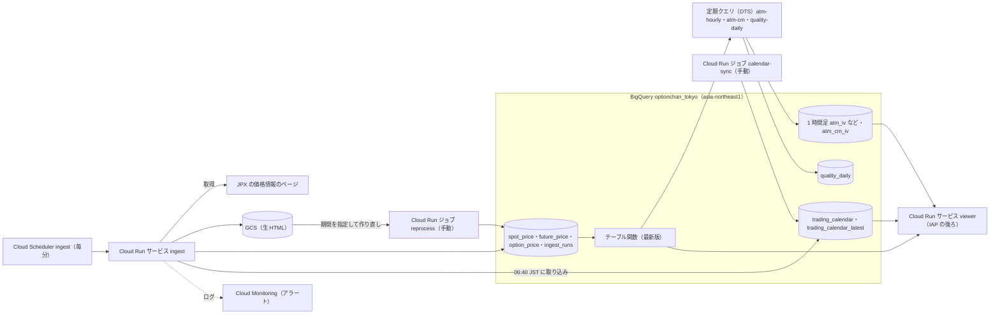

# optionchan for GCP

日経225オプションの価格を JPX のページから毎分取得し、Google Cloud の BigQuery に蓄積するツール。蓄積したデータは IAP の後ろのビューアー（ATM IV の推移・スマイルカーブ）で見る。GCP プロジェクトと GitHub リポジトリは clone した人それぞれのもので、このリポジトリに特定のプロジェクトの値は書かない（例は `<PROJECT_ID>`・`$P`・`<OWNER>/<REPO>`）。

## 何をするものか

- JPX の価格情報のページ（日経225オプション・先物・日経平均）を毎分取得する。取引時間中は分の頭から 8 秒待ってから取得する（`apps/ingest/src/optionchan_ingest/settings.py` の `FETCH_AT_SECOND`。#38）。立会時間（`settings.py` の定数）の外と休業日（取引カレンダー）は取得しない（立会の終わりの後も、ページの遅れのぶん 30 分は続ける）
- JPX のページ自体が約 15 分遅れなので、蓄積したデータも実時刻から約 15 分遅れる
- 生 HTML（2 ページを gzip した JSON）を GCS に、解析した行を東京（`asia-northeast1`）の BigQuery のデータセット `optionchan_tokyo`（Storage Write API）に書く
- 同じ分を回収・再処理で書き直すことがあるので、データは最新版を選ぶテーブル関数（`option_price_latest` など）で読む。表・列・時刻の読み方は [docs/data.md](docs/data.md)
- 最新版から定期クエリで 1 時間足（ATM の IV・プレミアム・行使価格）と 30 日固定の ATM IV を作り、日次で品質を検査する
- 構築はすべて Terraform（`infra/`）。master へのマージで GitHub Actions が plan し、Environment `prod` の承認の後に apply する

## 全体の図

新系（本番）の資源。名前は `infra/prod/*.tf` の資源の名前。

- 取り込みは毎時 0 分（JST）に取りこぼし（生 HTML はあるが完了記録 `ingest_runs` が無いもの）を回収し、07:00 に前日分を照合する。取引カレンダーは 06:40 JST の取り込みのリクエストが JPX から取り込む（ジョブ `calendar-sync` は手動の取り込み用）
- 定期クエリの時刻と窓は `infra/prod/sq.tf` の冒頭のコメント。旧系との突き合わせ（`legacy-stage`・`legacy-copy`・`legacy-compare`）は並行稼働の間だけで、図には載せていない
- イメージは Artifact Registry に置く。SA・WIF・tfstate・生 HTML のバケット・IAP のアクセス許可は `infra/bootstrap`（所有者が手で apply）

## 新系と旧系

- **新系**（`apps/`・`infra/`・`sql/`・`schema/tokyo` など）が本番。上の図がそれで、文書は新系を前提に書く
- **旧系**（`appengine/`・`functions/`・`functions_py/`・`memo.txt`）は、us-east1 の Cloud Functions（Pub/Sub・GCS 経由の取り込み、表示用の HTTP 関数）と App Engine のビューアー。今は新系と並行稼働していて、#14 で止め、#24 でコードと資源を消す。旧系の構成の記録は [docs/architecture/current.md](docs/architecture/current.md)
- 取り込み元（今は JPX のページ）の差し替えは #133 の後で書く

## ディレクトリ

| パス | 中身 |
|---|---|
| `apps/ingest` | 取り込み（Cloud Run の `ingest`・ジョブ `reprocess`・`calendar-sync`）。ジョブ `reprocess` は保存済みの生 HTML から期間を指定して作り直す（JPX にアクセスしない）。Python 3.13・uv |
| `apps/viewer` | ビューアー（Cloud Run の `viewer`、IAP の後ろ）。Python 3.13・uv・Flask、ブラウザ用の JS。使い方は [docs/viewer.md](docs/viewer.md) |
| `schema` | BigQuery の表の列の定義（`schema/tokyo/` は取り込みの表と日次チェックの結果、`schema/ohlc/`・`schema/cm/` は 1 時間足と 30 日固定）。旧系の表の定義も直下にある |
| `sql` | BigQuery の SQL。テーブル関数・定期クエリの本文（Terraform が読む）と、移行・過去分の作り直しで手で流す SQL |
| `infra` | Terraform。`infra/bootstrap`（権限の根元。所有者が手で apply）と `infra/prod`（CI が承認後に apply） |
| `monitoring` | Cloud Monitoring のアラートポリシーの定義（JSON）とバックテスト |
| `tests` | ルートのテスト（pytest。旧系の取り込み・監視の定義・workflow・Terraform・`sql/` の検査、文書の検査） |
| `.github/workflows` | `ci.yml`（PR のテスト・plan・イメージのビルド確認）と `deploy.yml`（master の plan・apply） |
| `docs` | 文書（下の「文書」） |
| `appengine`・`functions`・`functions_py` | 旧系（#14 で止め、#24 で消す） |
| `memo.txt`・`lifecycle.json` | 旧系の資源を手で作るコマンドと GCS の自動削除の設定（旧系） |

## 文書

読み手ごとの入口。用語は [docs/glossary.md](docs/glossary.md)。

- **(a) clone して自分の GCP で動かしたい人**
  - [docs/setup.md](docs/setup.md): 新しいプロジェクトで作る順番（tfstate と bootstrap → GitHub の設定 → prod（承認の前にビューアーの IAP の準備） → 取引カレンダー → 監視・予算）。各段は runbook の節へ案内する
- **(b) データを読む人（別のアプリの作り手）**
  - [docs/data.md](docs/data.md): データセット・テーブル関数・表の一覧・列・時刻・IV の種類・30 日固定の ATM IV の計算・クエリの例・権限
  - [docs/data-gaps.md](docs/data-gaps.md): 過去データの欠けと作り直しの記録
  - [docs/viewer.md](docs/viewer.md): ビューアーの画面とデータの API
- **(c) 開発する人**
  - [docs/development.md](docs/development.md): テストの種類と流し方・ローカルでの起動・CI・デプロイと承認・Terraform が読むファイル
  - 公開リポジトリの決まり（置くもの / 置かないもの）は [CLAUDE.md](CLAUDE.md)
- **取り込み元の差し替え（#133）**
  - [docs/tachibana-inquiry.md](docs/tachibana-inquiry.md): 立花証券 e 支店 API の利用が規約の範囲内かを確かめる問い合わせの下書き
- **(d) 運用する人**
  - [docs/runbook.md](docs/runbook.md): 確認・障害の対応・一度きりの作業の手順（先頭の目次から節へ）。取り込みは [`docs/runbook.md` の「新しい取り込み（ingest）」](docs/runbook.md#新しい取り込みingest)、Terraform は [`docs/runbook.md` の「Terraform」](docs/runbook.md#terraform)
- **設計の経緯**
  - [docs/architecture/current.md](docs/architecture/current.md): 刷新前（旧系）の構成の記録（2026-10-12 時点）
  - [docs/architecture/target.md](docs/architecture/target.md): 刷新の設計案・決定事項・コスト見積もり（設計時点の記録。今の構成はこの README と上の文書が正）

## 費用の目安

- 月額の見積もりは [docs/architecture/target.md の「7. コスト見積もり（月額・概算）」](docs/architecture/target.md#7-コスト見積もり月額概算)（設計時点の概算）
- 実際の費用の見方・予算・クエリ量の上限は [`docs/runbook.md` の先頭の節「コスト」](docs/runbook.md#コスト)。ビューアーのクエリの費用は [docs/viewer.md](docs/viewer.md#費用)

## JPX のページの利用について

このツールは JPX の公開ページを毎分取得する。取得の頻度・データの保存や利用が JPX の利用条件に合うかは、使う人がそれぞれ確かめる。

## 30 日固定の ATM IV（#100）

ATM の put の IV は、ATM が隣の行使価格に移ったときと限月の乗り換えで段差が出る。30 日固定の ATM IV は、限月ごとにフォワード価格の位置で補間した ATM IV を満期 30 日に補間した合成の指標で、どちらの段差も無い（日経VI とは計算が違い、値も一致しない）。表 `atm_cm_iv` に定期クエリ `atm-cm` が毎時足し、ビューアーの `/atm_iv` の限月「30日固定」で見る。#114 で約定から作った区間（気配が無い）は、約定 IV と先物から作った行（列 `basis = 'trade'`。`sql/cm_trade/`、#158）で埋める。

計算の手順・閾値・確かめたこと・出せる割合は [docs/data.md の「30 日固定の ATM IV の計算」](docs/data.md#30-日固定の-atm-iv-の計算)。計算の本文は `sql/cm/atm_cm.sql` の `-- cm:begin`〜`-- cm:end`。
