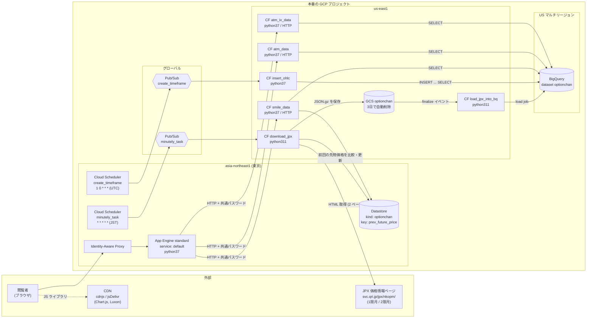
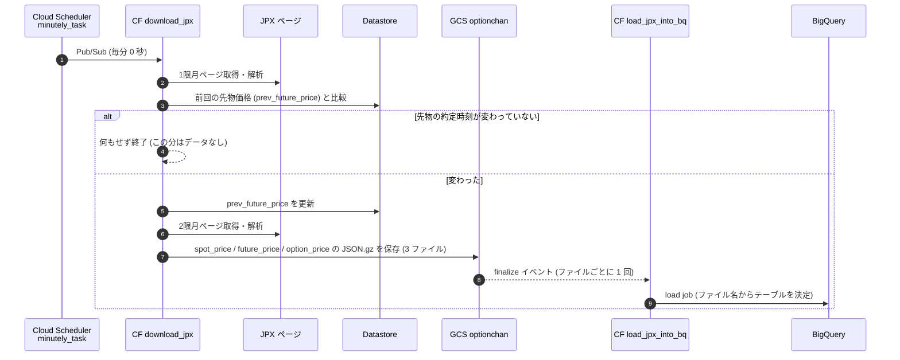
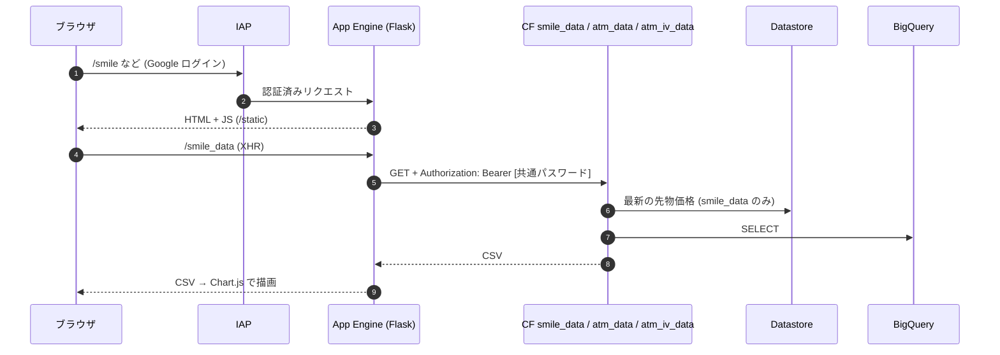

# 現行アーキテクチャ（リファクタリング前）

- 時点: **2026-10-12**（本番 GCP の実状態と `master` を調べて作成。同日の PR #6 のマージと `download_jpx` のデプロイまでを反映）
- 位置づけ: アーキテクチャリファクタリングの **Before** 資料。After と比較するため、現状を事実ベースで記録する。良し悪しの判断は末尾の「現行の課題」にまとめる
- GCP プロジェクト: 本番のプロジェクト（ID はリポジトリに書かない。コマンドでは `<PROJECT_ID>` / runbook の `$P`）

## 1. 概要

日経225オプション・先物・日経平均の価格を JPX の価格情報ページから **毎分スクレイピング**し、GCS を経由して BigQuery に蓄積する。蓄積したデータは App Engine 上のビューアー（Chart.js）で可視化する。

- 取り込み: Cloud Scheduler → Pub/Sub → Cloud Functions → GCS → Cloud Functions → BigQuery
- 集計: 日次で 1 時間足（OHLC）を BigQuery 内で生成
- 閲覧: App Engine（IAP で保護）→ HTTP の Cloud Functions → BigQuery

JPX のページ自体が約 15 分遅れのデータなので、蓄積データも実時刻から約 15 分遅れる。

## 2. システム構成図（インフラ）



リージョンが 3 つに分かれている点に注意: Scheduler・App Engine・Datastore は東京、Cloud Functions と GCS はバージニア（us-east1）、BigQuery は US マルチリージョン。

## 3. 処理フロー

### 3.1 毎分の取り込み



- 「先物価格が動いていない分は保存しない」仕様のため、取引時間中でも 25〜40% の分はデータが無い（2026-10 の実績）
- 1 スナップショット = 1限月・2限月の全行使価格 × コール/プット（約 1,000 行）
- Datastore の更新が GCS 保存・BigQuery ロードより先に行われるため、数秒〜十数秒の間、Datastore の「最新時刻」に対応するデータが BigQuery に無い（#5 の原因）
- 失敗時のリトライは無効（`download_jpx` は retry 設定なし）

### 3.2 日次の 1 時間足生成

- `create_timeframe`（毎日 00:01 UTC = 09:01 JST）→ `insert_ohlc`
- `option_price` の ATM 行から 1 時間足の OHLC を作り、`atm_iv` / `atm_option_price` / `atm_target_price` に INSERT する（BigQuery 内で完結）

### 3.3 閲覧



| ページ | データ API（App Engine） | 呼び出す関数 | 主に読むテーブル |
|---|---|---|---|
| `/smile` スマイルカーブ | `/smile_data` | `smile_data` | `option_price`（Datastore の最新時刻と同じ `created_at`） |
| `/atm` ATM 推移 | `/atm_data` | `atm_data` | `option_price`（直近 7 日、5 分平均） |
| `/atm_iv` ATM IV 推移 | `/atm_iv_data?d=&n=` | `atm_iv_data` | `atm_iv`、`option_price` |

## 4. リソース一覧

### 4.1 コンピュート

| リソース | 種別 | リージョン | ランタイム | トリガー | メモリ / タイムアウト | 最終デプロイ | ソース |
|---|---|---|---|---|---|---|---|
| `download_jpx` | Cloud Functions 第1世代 | us-east1 | python311 | Pub/Sub `minutely_task` | 512MB / 60s（2026-10-12 に 256MB から変更。依存更新でメモリ超過） | 2026-10-12 | `functions/` |
| `load_jpx_into_bq` | Cloud Functions 第1世代 | us-east1 | python311 | GCS `optionchan` finalize | 256MB / 60s | 2024-08-06 | `functions/` |
| `insert_ohlc` | Cloud Functions 第1世代 | us-east1 | **python37** | Pub/Sub `create_timeframe` | 128MB / 540s | 2023-04-25 | `functions_py/timeframe/` |
| `smile_data` | Cloud Functions 第1世代 | us-east1 | **python37** | HTTP | 256MB / 60s | 2019-05-13 | `functions/` |
| `atm_data` | Cloud Functions 第1世代 | us-east1 | **python37** | HTTP | 256MB / 60s | 2019-05-13 | `functions/` |
| `atm_iv_data` | Cloud Functions 第1世代 | us-east1 | **python37** | HTTP | 256MB / 60s | 2019-12-18 | `functions_py/atm_iv/` |
| ビューアー | App Engine standard（service `default`） | asia-northeast1 | **python37** | HTTP（IAP） | 自動スケール（`max_idle_instances: 1`） | 2019-07-03 | `appengine/` |
| `stackdriverLineNotify` | Cloud Functions 第1世代 | asia-northeast1 | **nodejs10** | HTTP | 128MB / 60s | 2019-04-24 | 別リポジトリ（#20 で削除済み、2026-10-12） |

- すべての関数・App Engine は App Engine のデフォルトサービスアカウントで動いている
- App Engine にはバージョンが 30 個残っている（トラフィックは 2019-07-03 の 1 バージョンに 100%）
- `stackdriverLineNotify` は監視アラートを LINE に転送するためのもの（README によると別リポジトリに切り出し済み）。#20 で関数・webhook 通知チャネルを削除し、アラートポリシーの通知先から外した（2026-10-12）。ソースはリポジトリ外のローカルに退避

### 4.2 スケジューラ・メッセージング

| リソース | 内容 |
|---|---|
| Cloud Scheduler `minutely_task` | `* * * * *`（Asia/Tokyo）→ Pub/Sub `minutely_task`。土日・夜間も含めて毎分起動 |
| Cloud Scheduler `create_timeframe` | `1 0 * * *`（UTC）→ Pub/Sub `create_timeframe` |
| Pub/Sub `minutely_task` / `create_timeframe` | 各 1 サブスクリプション（Cloud Functions のトリガー用） |
| Pub/Sub `minutely15_task` | サブスクリプションなし（未使用） |
| Pub/Sub `cloud-builds` | Cloud Build が使うトピック（optionchan の処理とは無関係） |

### 4.3 ストレージ・データ

| リソース | 場所 | 内容 |
|---|---|---|
| GCS `optionchan` | us-east1 | 取り込みの中継。`{spot,future,option}_price_YYYYMMDDHHMMSS.json.gz`。作成 3 日後に自動削除（`lifecycle.json`）。約 4,100 ファイル / 34MB |
| BigQuery dataset `optionchan` | US | 本番データ（下表）。保存料金は 2026-10-12 に論理サイズ課金から物理サイズ課金へ切り替えた（`option_price` は論理 78GB / 物理 4.8GB） |
| Datastore（Datastore モード） | asia-northeast1 | `optionchan` / `prev_future_price` の 1 エンティティのみ（前回の先物価格） |
| BigQuery dataset `jikken` / GCS `jikken` | US / us-east1 | 2019 年の実験用。GCS は約 6.5GB |
| BigQuery dataset `PaymentInfo` | US | 課金データのエクスポート先（optionchan 本体とは無関係） |
| GCS `gcf-sources-*` / `*.appspot.com` / `*artifacts*` | 各所 | デプロイ時に GCP が作るもの（関数ソース zip、App Engine のステージング等） |

BigQuery `optionchan` のテーブル（2026-10-12 時点）:

| テーブル | 行数 | サイズ | パーティション | クラスタリング | 書き込み元 |
|---|---|---|---|---|---|
| `option_price` | 約 6.5 億 | 約 78GB | `created_at`（日） | `last_trading_day` | `load_jpx_into_bq` |
| `future_price` | 約 141 万 | 約 80MB | `created_at`（日） | `contract_month` | `load_jpx_into_bq` |
| `spot_price` | 約 142 万 | 約 70MB | `created_at`（日） | なし | `load_jpx_into_bq` |
| `atm_iv` | 約 7.8 万 | 約 4MB | `started_at`（日） | `last_trading_day` | `insert_ohlc` |
| `atm_option_price` | 約 7.8 万 | 約 4MB | `started_at`（日） | `last_trading_day` | `insert_ohlc` |
| `atm_target_price` | 約 7.8 万 | 約 4MB | `started_at`（日） | `last_trading_day` | `insert_ohlc` |

スキーマは `schema/*.json`。時刻列は `created_at` / `started_at` が TIMESTAMP、`price_time` が DATETIME（JST の naive 値）。

### 4.4 セキュリティ・認証

| 対象 | 仕組み |
|---|---|
| ビューアー（App Engine） | IAP で Google ログインを要求 |
| App Engine → HTTP 関数 | 関数は `allUsers` に invoker を付与（誰でも呼び出せる）。関数内で `Authorization: Bearer` を `auth.txt` の共通パスワードと照合 |
| 共通パスワード | `auth.txt`（gitignore 済み）を `functions/`・`functions_py/atm_iv/`・`appengine/` に置いてデプロイ。デプロイされたソース zip に平文で含まれる（#3） |
| サービスアカウント | 実行はすべて App Engine デフォルト SA。別に `optionchan` SA があり（BigQuery 管理者・Datastore オーナー・Storage オブジェクト管理者）、SA 鍵が発行されている（2019 年）。ユーザー管理の鍵 2 本は最終認証の記録が無く、2026-10-12 に無効化（#23。削除は #15、手順は `docs/runbook.md` の「サービスアカウント鍵」）。Compute Engine / App Engine のデフォルト SA には `roles/editor` が付いている |
| プロジェクト | 組織に属さない（IAP の OAuth クライアントをプログラムで作れない制約に関係） |

### 4.5 監視・ログ

- ログは Cloud Logging の既定（`_Default` / `_Required`）のみ。エクスポートなし
- アラートポリシー（#9 で追加）: `optionchan: M1 生存（download_jpx の起動が 15 分無い）`（`download_jpx` の組み込み指標 `execution_count` が 15 分間 無い）と `optionchan: M2 エラー（取り込み関数の失敗）`（`execution_count` の status が `ok` 以外の実行が、`download_jpx` / `load_jpx_into_bq` で関数ごとに 15 分間に 3 件以上、または `insert_ohlc` で 1 件以上）。メール通知チャネルへ通知。ログ指標は使わない。Terraform 管理外で、定義は `monitoring/`、手順は `docs/runbook.md` の「監視アラート」。鮮度（JPX のページが更新されない）・load job の非同期の失敗・データ品質は検知しない。ほかに別サーバーの死活監視のポリシーが 1 件
- 通知チャネルはメールと LINE Notify（webhook）。LINE Notify は 2025-03-31 にサービスを終了しているため、LINE への通知は届かない状態と考えられる（#20 で webhook チャネルを削除済み、2026-10-12。通知チャネルはメールのみ）
- 予算アラート（#21 で追加。2026-10-12 に設定）: 表示名 `optionchan: 月額予算`。このプロジェクトのみを対象に暦月 500 円、実績の 50 / 80 / 100% でメール通知チャネルへ通知（請求先アカウントは他プロジェクトと共有のため、IAM ロール保持者への既定メールは無効）。課金は止めない。Terraform 管理外で、手順は `docs/runbook.md` の「コスト」
- BigQuery の 1 日あたりクエリ量の上限（#21 で追加。2026-10-12 に設定）: プロジェクト単位の `QueryUsagePerDay` を 32 GiB/日（32768 MiB、Service Usage の consumer override。既定は 200 TiB/日）。ユーザー単位は無制限のまま。超えると太平洋時間の 0 時まで `insert_ohlc` とビューアーのクエリが失敗する（毎分の LOAD ジョブは対象外）

## 5. ソフトウェア構成

```
optionchan-gcp/
├── functions/              # 4 関数で共有するソース (download_jpx, load_jpx_into_bq, smile_data, atm_data)
│   ├── main.py             #   各関数のエントリポイント、GCS 保存、BigQuery ロード、Datastore 比較
│   ├── jpx_loader.py       #   JPX ページの取得と HTML 解析 (pyquery)
│   ├── models.py           #   OptionPrice / FuturePrice / SpotPrice (dataclasses-json)
│   ├── optionchan_dao.py   #   BigQuery / Datastore の読み出し (表示用)
│   └── config.py, my_logging.py, requirements.txt
├── functions_py/
│   ├── timeframe/          # insert_ohlc (1 時間足生成。SQL のみ)
│   └── atm_iv/             # atm_iv_data (ATM IV 推移の API)
├── appengine/              # ビューアー (Flask + Jinja テンプレート + Chart.js)
│   ├── main.py             #   ページと、HTTP 関数への中継
│   ├── templates/, static/
│   └── app.yaml
├── schema/                 # BigQuery のテーブルスキーマ (JSON)
├── monitoring/             # アラートポリシーの定義 (JSON) とバックテスト。#9 で追加
├── tests/                  # pytest (JPX ページの解析は #2、アラート定義とバックテストの判定は #9 で追加)
├── lifecycle.json          # GCS の自動削除設定
└── memo.txt                # リソース作成・デプロイのコマンド集
```

- 言語: Python（App Engine と HTTP 関数は 3.7、取り込み関数は 3.11）、JavaScript（Chart.js 2.3 / 2.8、Luxon）
- 主なライブラリ: Flask、requests、pyquery、pandas、google-cloud-bigquery / storage / datastore、dataclasses-json
- `functions/` は 1 つのディレクトリから 4 つの関数をデプロイしているが、関数ごとにデプロイ時期が違い、本番のソースもそれぞれ異なる
- 設定値（プロジェクト ID、バケット名、関数 URL 等）は各ディレクトリの `config.py` にハードコード

## 6. デプロイ・運用

- デプロイは手作業（`memo.txt` のコマンドを手で実行）。IaC・CI/CD は無い
- リソース（バケット、データセット、トピック、スケジューラ）も手作業で作成
- 本番と git の差: `download_jpx` / `load_jpx_into_bq` は 2024-08 のデプロイ内容が未コミットだった（2026-10-12 に PR #6 で取り込み、`download_jpx` を再デプロイ）。2024 年のデプロイではローカルの `venv/` などもアップロードされていた。python37 の関数と App Engine は git と本番の照合をしていない
- 監視は取り込みの停止・失敗のアラート 2 本（#9）。鮮度・データ品質の異常は閲覧時に気づく運用

## 7. 現行の課題（リファクタリングの論点）

| 分類 | 課題 |
|---|---|
| ランタイム | App Engine と 4 関数が python37（廃止済み。`stackdriverLineNotify`（nodejs10）は #20 で削除済み）。このままでは再デプロイできない可能性が高い |
| 世代 | Cloud Functions はすべて第1世代 |
| リージョン | 東京・us-east1・US に分散。関数↔BigQuery↔Datastore↔App Engine の通信がリージョンをまたぐ |
| 構成管理 | IaC なし。リソース作成・デプロイが手作業で、本番と git がずれる（ドリフト） |
| 品質 | CI なし。自動テストは `tests/`（#2 で JPX ページの解析、#9 でアラート定義）のみ |
| 認証 | 共通パスワードの平文配布（#3）。HTTP 関数が `allUsers` 公開 |
| 権限 | 全関数が App Engine デフォルト SA で動作。強い権限を持つ SA に SA 鍵がある（ユーザー管理の 2 本は 2026-10-12 に無効化、#23。削除は #15） |
| 整合性 | Datastore と BigQuery の更新順のずれで、取り込み直後に表示が失敗する（#5） |
| データ品質 | `price_time` の日付ずれ（#2）と過去データ（#4） |
| 監視 | 取り込み停止・失敗のアラートは #9 で 2 本追加（関数の実行数で判定）。鮮度・データ品質は検知できない。通知先の LINE Notify は終了済みで、#20 で関連リソースを削除（通知先はメールのみ） |
| コスト | 土日・夜間も毎分起動。`option_price` が 78GB で増え続ける（保持期限なし） |
| 残骸 | App Engine の旧バージョン 30 個、未使用トピック `minutely15_task`、`jikken`（BigQuery / GCS 約 6.5GB） |
| フロントエンド | ビューアーが App Engine に同梱。Chart.js のバージョンがページで混在 |
