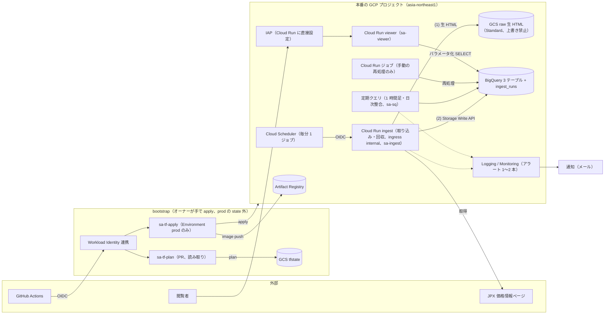

# 新アーキテクチャ（リファクタリング後・設計案）

- 時点: 2026-10-12（設計レビュー #17 を反映した改訂版。決定事項は「9. 決定事項」、レビュー指摘の扱いは「10. 設計レビューの反映状況」）
- 対になる資料: [現行アーキテクチャ](current.md)（Before）
- 方針: **モダン化・IaC 化・オブザーバビリティ強化**。個人プロジェクトなので「月額を今と同程度（実請求 約 160 円）に抑え、無料枠を活かす」「運用の手間を減らす」を同じくらい重視する
- 規模: **最小構成を基準**にする。本文の「必須」が最小構成、「任意」は要否を個別に判断する追加候補。ただしセキュリティの必須項目は削らない

## 1. 設計方針

| # | 方針 | 現行の課題との対応 |
|---|---|---|
| P1 | **すべて Terraform で管理**し、デプロイは GitHub Actions から行う。ただし権限の根元（bootstrap）は分離してオーナーが手で apply する | IaC なし、ドリフト |
| P2 | **リージョンを 1 か所に集約**する。**東京（asia-northeast1）**に集約する（2026-10-12 決定、D2・2.1） | 3 リージョン分散 |
| P3 | 実行基盤は **Cloud Run** に統一し、**App Engine と第1世代 Cloud Functions をやめる** | 廃止ランタイム、第1世代 |
| P4 | 認証は **IAP と IAM に寄せ、共有パスワードを無くす**。`allUsers` 公開をやめる | #3、公開エンドポイント |
| P5 | サービスごとに **専用サービスアカウント（最小権限）**。ユーザー管理の SA 鍵は使わない（CI も Workload Identity 連携） | デフォルト SA（Editor）、SA 鍵 |
| P6 | 取り込みは **生データ（HTML）を保存してから解析**する。解析のバグを後から再処理で直せるようにする | #4（元の `MM/DD` が残っておらず過去データを正確に直せない） |
| P7 | 書き込み順を「生 HTML → データ → 完了記録（`ingest_runs`）」にし、**表示側は完了記録のあるデータだけを見る** | #5、部分書き込み |
| P8 | **監視を最初に入れる**。アラートは 1〜2 本に絞り（2027-09 から課金。公式 https://cloud.google.com/stackdriver/pricing で 2026-10-12 に確認。"no sooner than" 2027-09-01）、細かい検査はコードと定期クエリで行う | 監視なし、LINE Notify 終了 |
| P9 | 集計は関数ではなく **BigQuery の定期クエリ / ビュー**で行う | `insert_ohlc`（python37） |

## 2. システム構成図（After）



なくなるもの: App Engine、Cloud Functions 7 個、Pub/Sub 3 トピック、Datastore、GCS `optionchan`（中継）、共有パスワード（`auth.txt`）、`stackdriverLineNotify`。

### 2.1 リージョン: 東京案 / US 集約案（東京案に決定）

| | 東京案 | US 集約案 |
|---|---|---|
| Cloud Run・GCS raw | asia-northeast1 | US のリージョン（例: us-central1。BigQuery US マルチリージョンと同じ地域） |
| BigQuery | 新データセット `optionchan_tokyo` に過去データをコピー | 既存 `optionchan` を読み取り専用で残し、新データは同じ US の新データセット（例: `optionchan_v2`）へ。境界時刻 T0 で結合するビューで 1 つに見せる |
| データ移行（6 章 3a） | 必要（コピー・検証で約 1 週間、転送料 約 60 円） | **不要** |
| 期待される利点 | JPX への距離が近く、取得時間・課金時間が短い可能性 | 移行作業とリスクが小さい。`PaymentInfo`（課金エクスポート）も US にあり分散しない |
| 保存単価 | US より 1 割強高い | 現行どおり |

**2026-10-12 にオーナーの判断で東京案に決定した**（D2）。両リージョンを比べる判定スパイク（#19）は行わず、下の計測項目は東京だけで、フェーズ 2 の並行稼働（#11）の中で測る（Cloud Run の課金時間は 7 章の試算の確認に、JPX ページ更新時刻の挙動は鮮度のしきい値の調整に使う）。US 集約案の列と判定基準は検討の記録として残す。

| 測るもの | 指標 |
|---|---|
| JPX 取得時間 | 1 ページの取得時間 p50 / p95、失敗率（タイムアウト・接続断） |
| Cloud Run の課金時間 | 1 回あたりの課金対象インスタンス時間（更新あり / 更新なし / 時間外の 3 経路） |
| コールドスタート | 起動遅延の p50 / p95、毎分起動でインスタンスが残る割合 |
| JPX ページ更新時刻の挙動 | 更新間隔、実時刻との遅れ、1 限月と 2 限月の更新時刻のずれ、4 時台の空ページ |

判定基準（案。東京案に決定したため使わない）:

1. 東京の更新あり経路の処理時間 p50 が US より **30% 以上短く**、かつ月の vCPU 秒試算（7 章）で無料枠に収まるかどうかが変わる → 東京案
2. US の取引時間中の失敗率が東京より **1 ポイント以上高い** → 東京案
3. どちらにも当たらない → 移行作業の少ない **US 集約案**

## 3. コンポーネント設計

### 3.1 取り込み（ingest）

**実行基盤（必須）**

- **Cloud Run サービス 1 つ**（Python 3.13、最小インスタンス 0、**CPU 0.5**、メモリ 512MiB 程度）。1 vCPU 未満は第1世代実行環境・同時実行 1・リクエスト課金が条件で、0.5 vCPU ではメモリ上限が 1GiB 未満になる（[公式](https://docs.cloud.google.com/run/docs/configuring/services/cpu)）。0.5 未満にはしない。ジョブにしないのは、ジョブはインスタンスごとに最低 1 分課金で、毎分起動には向かないため
- ingress は `INGRESS_TRAFFIC_INTERNAL_ONLY`（同一プロジェクトの Scheduler から `run.app` URL を呼ぶ場合は内部扱い）+ IAM 認証 + OIDC の audience 固定
- **Cloud Scheduler は `* * * * *` の 1 ジョブだけ**（Scheduler の無料枠は請求先アカウントあたり 3 ジョブで、既に他で使い切っている）。リトライ 0、`attemptDeadline` と Cloud Run のリクエストタイムアウトを 50 秒前後に揃える。`X-CloudScheduler-ScheduleTime` はリトライ間で一定なので、リトライ 0 でも念のため重複排除のキーに使える
- **取引時間・休場日の判定はコード側 1 か所**（取引時間は ingest のコードの定数。休業日は JPX「祝日取引」の表から毎日自動で取り込んだ BigQuery の版だけが正で、読めなければ直前に読めた版、起動直後で一度も読めていなければ休業日なし（土日以外はすべて取引日）として ERROR。#63・#75、3.2「取引カレンダー（#63）」）。時間外は 204 で即返す。祝日取引から除外される日がある（例: 2026-11-23、12/31、1/1、1/2）。実測ではページ時刻のデータ範囲は 08:45〜15:46 / 17:00〜06:01 で、実時刻はその約 15 分後
- JPX への HTTP は接続・読み取りとも**タイムアウト 10 秒程度**（現行の `requests.get` はタイムアウト無し）

**スナップショットの識別子と保存条件**

- 識別子 = **1 限月ページの更新時刻**（JST）。保存条件は「ページ更新時刻が前回保存分から変わったら」
- 現行は「先物の約定時刻（時:分）が変わったら保存」（`update_prev_future_price_if_changed`）で、件数が変わりうる（1 日 約 800 回 vs 最大 約 1,200 回、未確認）。実測で `created_at` の重複が 2026 年に 34 件（中身が異なる）、spot / future の片方だけのスナップショットが 2025 年 36 件・2026 年 8 件ある。**新旧の判定差は並行稼働で比較し、#11 の AC にする**

**処理順（必須）**

1. 1 限月のページを取得し、更新時刻から生 HTML のオブジェクト名（`raw/YYYY/MM/DD/YYYYMMDDTHHMM.json.gz`。JST のページ時刻）を決める。オブジェクトが既にあれば終了（HEAD 1 回。この「更新なし」経路は JPX の取得を含むので時間は並行稼働（#11）で測る）
2. 2 限月のページも取得し、2 ページ分を 1 ファイル（gzip した JSON の封筒 `{"format": 1, "pages": [{"page", "url", "fetched_at", "http_status", "updated_at", "html"}]}`。UTF-8 でない本文は `html_b64`。`Content-Encoding` は付けない）にまとめて **`ifGenerationMatch=0`（上書き禁止）で作成**する。412 なら他の実行が処理済みなので終了（ロック兼重複排除）
3. 解析して `spot_price` / `future_price` / `option_price` の行を作る（純粋関数。年は `datetime.now()` ではなく HTML 内の更新時刻から決める。#2 のテストと古い HTML 断片を回帰テストにする。先物の限月は表示の年（`YY年MM月限`）をそのまま使う。旧パーサーは「限月の 1 日が更新時刻より前なら翌年」にしており、SQ のある月の 1 日〜限月交代に翌年の限月を記録している（2025-12-01〜12-11 の実データで確認。新旧突き合わせでは説明済みの差として扱う））
4. **Storage Write API** で 3 テーブルに追記する（旧ストリーミング挿入 `insertAll` は使わない）
5. 最後に完了記録 **`ingest_runs`** に 1 行書く（snapshot 時刻、`ingest_run_id`、テーブルごとの行数、`source_object`、`parser_version`）

- 「処理済みか」は GCS のオブジェクトと `ingest_runs` で判定し、**BigQuery の最新 `created_at` を毎回クエリしない**（最低課金 10MB × 月 2.5 万回 ≒ 250GB、遅延 1〜2 秒）
- **部分書き込み・重複への対処**: 追記のみとし、表示・集計は「`ingest_runs` に完了記録がある実行のうち、スナップショットごとに最新の `ingest_run_id`」を選ぶテーブル関数（3.2、#34）を通す。途中で落ちた実行の行は見えない。Storage Write API の exactly-once は同一ストリーム内のオフセット一致のときだけで、3 テーブル一括のコミットは未確認（実装時に確認）のため、これに頼らない
- **取りこぼしの回収（必須）**: **ingest サービスの中で行う**（Scheduler を増やさない）。毎時 0 分の呼び出し（取引時間中は通常処理の後）で、直近の GCS raw の一覧と `ingest_runs` を突き合わせ、完了記録の無い生 HTML を解析し直す。1 回あたりの件数に上限を設け、リクエストタイムアウト内に収める
  - 実装（#34）: 0 分の判定は Scheduler の予定時刻（`X-CloudScheduler-ScheduleTime`、無ければ実時刻）を JST にした分。窓は名前の時刻が直近 6 時間、対象は完了記録が無く作成から 3 分以上のもの（実行中の取り込みと重ならない）を古い順に最大 10 件。通常の処理と同じ期限 45 秒を共有し、1 件を始めるのは残り 15 秒以上のとき（取引時間中は #38 の待ちと通常の処理の後なので、残りはおよそ 30 秒）。作成から 3 分以上の生 HTML が無ければ BigQuery にクエリしない。`trigger = recovery`、今の `PARSER_VERSION`、新しい `ingest_run_id` で 3 テーブル → `ingest_runs` の順に追記する（書き込みの部品は毎分の取り込みと共用）。解析の失敗は WARNING（元の実行が ERROR を出し済み）、書き込みの失敗は ERROR。回収の結果・失敗は応答を変えない
  - クエリ: `ingest_runs` の `source_object` を窓 ±1 分の `snapshot_at` で引く（jobs.query の REST、google-auth の `AuthorizedSession`。`google-cloud-bigquery` は足さない）。失敗したらその回の回収はしない（全件を再取り込みしない）
- **日次の照合（#34）**: 07:00 JST の回（時間外）に、回収の後で前日 07:00〜当日 07:00 の生 HTML の数・完了記録のある数・未回収の数と名前（先頭 20 件）を INFO `raw_reconciled` で出し、未回収が 1 件以上なら ERROR `raw_unrecovered`（#11 の AC 4 の日次の数値）。照合の分の時間（15 秒）は回収に使わせない

**失敗の分類（必須）**

| 種別 | 例 | 扱い |
|---|---|---|
| `jpx_unavailable`（WARN） | 空ページ・接続断（4 時台に毎日発生） | 次の分に任せる。単発ではアラートしない。取引時間中に続き、最後に保存できた生 HTML が鮮度のしきい値より古ければ ERROR `jpx_unavailable_stale`（#42。M2 で通知） |
| `parse_failed`（ERROR） | 形式変更、構造の検査の違反（2 限月そろわない、限月ごとに call と put の行数が違う、限月 × 種別ごとに ATM がちょうど 1 行でない、限月ごとの行使価格が下限 10 個未満、`created_at` が全行で同じでない、キー重複）。行数の固定下限は使わない（2026-09〜10 の実測で 1 スナップショット 84〜1,080 行と変動する。行数の分布は並行稼働（#11）で記録） | 生 HTML は残し、`ingest_runs` は書かない。アラート対象 |
| `write_failed`（ERROR） | BigQuery 書き込み失敗 | 回収処理で再処理。**初回から M2 で通知** |

- 行数・限月は SQ・限月交代で入れ替わるので、構造の検査と品質チェックはそれを考慮する

**再処理（必須）**

- 同じコンテナを引数違いで動かす **Cloud Run ジョブ**。**手動の期間指定再処理・バックフィル専用**で、定期起動しない（定期の回収は上記のとおり ingest サービスが行う）
  - 実装（#34）: ジョブ `reprocess`（`python -m optionchan_ingest.reprocess --start <ISO8601> --end <ISO8601> [--only-missing] [--dry-run] [--limit N]`、タイムゾーン付き必須）。名前の時刻が `[start, end)` の生 HTML を読み直し、今の `PARSER_VERSION` で `trigger = reprocess` として追記する（1 件の処理は回収と共用）。アプリの期限 3300 秒（タスクのタイムアウト 3600 秒、リトライ 0）。終了コード 0 / 1（失敗あり）/ 2（引数）/ 3（期限で途中終了）。手順は runbook「再処理ジョブ」
- 置換方法は 2 つ:
  - (b) 既定: 追記のみ。新しい `ingest_run_id` で書き、最新版の選択（3.2 のテーブル関数）で最新版を選ぶ（#34 で実装）
  - (a) 大量・恒久の置換（未実装。#4 で必要になったときに作る。#12 の過去データの移行は置換ではなく、新系の記録の無いスナップショットへの追記）: 1 日以上前のパーティションに限り、一時テーブルからパーティション単位で DELETE + INSERT（通常の取り込みと期間で排他。Storage Write API で 30 分以内に書いた行には DML の制約がある）

### 3.2 データ（BigQuery）

- データセット: `optionchan_tokyo`（新規、asia-northeast1。東京案に決定、D2）。データセットのロケーションと名前は後から変えられない
- テーブルは現行のスキーマを基本に維持し、次を追加する（必須）:
  - `ingest_run_id`、`parser_version`、`source_object`（生 HTML のパスと generation）
  - `page_updated_at`: その行を取ったページの更新時刻（現行は 1 限月の時刻に揃えて上書きしている。`created_at` は従来どおり 1 限月の更新時刻）
  - `price_time_raw`: ページの約定日時の表示（`MM/DD HH:MM`）。#4 の推定ロジックの検証にも使う
  - 追加列はすべて NULLABLE（旧データを INSERT…SELECT で入れられるように）。定義の正は `schema/tokyo/*.json`、データセット・パーティション・クラスタの設定は `schema/tokyo/tables.json`（11b の Terraform が読む）
  - `ingest_runs` テーブル（完了記録）
- `price_time` は DATETIME（JST）のまま。列の説明に JST と明記する
- `option_price` は `require_partition_filter = true`、テーブル関数は期間引数を必須にする。パーティションは UTC 日単位で、JST の取引日（夜間取引）をまたぐ
- **最新版の選択（#34）**: テーブル関数 `latest_runs(start_at, end_at)` と `spot_price_latest` / `future_price_latest` / `option_price_latest`（同じ引数、`[start_at, end_at)`）。`ingest_runs` にある実行だけを対象に、`snapshot_at` ごとに `finished_at` が最も新しい 1 件（同時刻なら `ingest_run_id` の大きい方）を選び、その `ingest_run_id` の行だけを返す（完了記録の無い残骸は内部結合で落ちる）。ビューでなくテーブル関数にするのは、期間引数を必須にして `option_price` の `require_partition_filter` と `ingest_runs` の全件スキャンを避けるため。本文は `sql/latest/`（Terraform の `google_bigquery_routine` が読み、プロジェクト・データセット名を入れる）。生テーブルを直接数えない（runbook「最新版の読み方」）
- **1 時間足**（現 `insert_ohlc`）は定期クエリにする。現行は ATM かつ type=2、UTC 基準で前日 1 日分、`CURRENT_TIMESTAMP` 基準、単純 INSERT で、実測でキー重複（`atm_iv` 84 行、`atm_option_price` 42 行）がある。新方式は `@run_time` 基準、`(last_trading_day, time_frame, started_at)` で MERGE、`SAFE_OFFSET` を使い、再処理した日は再計算する。**過去 30 日分で現行と同値**を確認してから切り替える
  - 実装（#49）: スケジュールされたクエリ `atm-hourly`（asia-northeast1、毎日 07:40 JST、実行 SA `sa-sq-dts`。#40 の 4 本の後）。窓は品質チェックと同じ `[D-1 07:00, D 07:00) JST`、`option_price_latest` の ATM の put から限月 × 1 時間（UTC の正時 = JST の正時）の OHLC を作り、`optionchan_tokyo.atm_iv` / `atm_option_price` / `atm_target_price`（列は旧系と同じ、パーティションは月、クラスタは `last_trading_day`）へ MERGE する（窓の中を置き換える。ATM の行が無い窓は何もしない。3 表は 1 トランザクション）。意味は旧系と同じで、`created_at` が同じ行の順だけ `target_price` で決める。再処理・回収・移行で最新版が変わった日は DTS の手動実行で作り直す。2026-09-12〜10-12 で旧 `option_price` に同じ計算を当てると旧 3 表と一致し、違いは UTC 23 時台（旧系の集計の時点で未着だった 08:45〜08:59 JST の行）だけ。過去分は #12 の一時データセットから、新系の最初の窓より前の旧 3 表の行を移す（同じ中身の重複は 1 行、中身の違う重複のキーは移さずに再計算）。本文は `sql/ohlc/`、手順は runbook「1 時間足（#49）」
- **取引カレンダー（#63）**: 休業日の一覧を JPX「祝日取引」の祝日取引実施日の表から取り込み、検証した版をテーブル `trading_calendar` に追記する（追記のみ、パーティション無し、削除保護）。最新版はビュー `trading_calendar_latest`。休業日の正はこの版だけで、ファイルの写しは持たない（#75）。ingest のほか、別リポジトリのシミュレーター等がビューを直接読む**契約**:
  - 列（正は `schema/tokyo/trading_calendar.json`。変えるときは読み手と合意し、追加は NULLABLE で末尾に。改名・削除・型の変更はしない）: `version_at` TIMESTAMP（版の識別子）、`calendar_date` DATE、`is_trading_day` BOOLEAN、`status` STRING（`confirmed` / `planned`）、`day_type` STRING（`national_holiday` / `year_end`）、`name` STRING、`note` STRING（NULLABLE）、`source` STRING（`jpx_table` / `rule` / `history`（#67 で追加））、`covered_until` DATE・`listed_until` DATE・`accepted` STRING（`auto` / `override`）（版の値で全行同じ）、`content_hash` STRING（版の値。版の内容の SHA-256。読み手は行の欠け・重複の検知に使える。ingest は再計算して一致しなければ使わない）
  - 1 行は「業務規程上の休業日に当たる平日 1 日」（国民の祝日・休日と年末年始の 12/31・1/1・1/2・1/3）。土日の行は無い。1 版の中で日付は一意。表に載らない平日の 1/1 は規則で足す（`source = rule`）。表から消えた過去年の行は前の版から引き継ぐ
  - **過去年（#67）**: 取り込み開始時の表より前の年（2018〜2025 年）は、内閣府の祝日 CSV と JPX「祝日取引実施日（確定）一覧」（xlsx、「祝日取引」のページからリンク）から作った行を一度だけ足した（`source = history`、`status = confirmed`）。祝日取引の開始（2022-09-23）より前は平日の祝日・休日と年末年始がすべて休業（`is_trading_day = false`、`note` は「祝日取引の開始前」）、開始以後の実施有無・名称は xlsx（1/1 は xlsx に載らないので休業。`name` は xlsx に無い日は CSV の名称、年末年始は 年末休業日 / 年始休業日）。大阪取引所のデリバティブの終日の臨時休場は 2018 年以降に無い（2020-10-01 の東証の売買停止は現物だけで、デリバティブは取引あり）ので行は無い。以後の版はこの行を引き継ぐ
  - 最新版の選び方: `version_at` が最大の版（`SELECT * FROM optionchan_tokyo.trading_calendar_latest`）。生テーブルを読むときも `version_at` で 1 版に絞る
  - **掲載範囲**は版の `MIN(calendar_date)` の年の 1/1 〜 `listed_until`。その外の平日は未知（休業日が載っていない）。開始は 2018-01-01（#67 の埋め戻しの後。前は取り込み開始時の表の最初の年 2026 年）
  - **取引日** = 土日と `is_trading_day = false` の日を除いた日（掲載範囲の外の平日は未知。ingest は取引日として扱う）。`covered_until` より後は予定（変わりうる）
  - **SQ 日・取引最終日の繰り上げ**には、`is_trading_day` に関係なく**全行**を休業日として使う（祝日取引の実施日も業務規程上は休業日。例: 2023-08 限は SQ 日 8/11（山の日）が 8/10 に繰り上がり、取引最終日は 8/9）。ingest は限月・取引最終日をページから読むので使わない
  - 権限: `optionchan_tokyo` の `bigquery.dataViewer` とプロジェクトの `bigquery.jobUser`。公開 URL は作らない
- 表示用の集計（スマイルカーブ・ATM 推移）は **ビュー / テーブル関数**（上記の最新版選択のテーブル関数の上に作る）
- 古いパーティションは長期保存料金に任せ、削除しない。タイムトラベルは既定の 7 日

**過去データの補正（#4、移行とは別ステップ）**

- コピー（東京案）や結合ビュー（US 案）は**元データのまま**行い、検証が済んでから補正する
- 補正は移行行の `price_time` をその場で UPDATE し（日付だけ。時刻は変えない）、`price_time_raw` に補正前の `price_time`（`YYYY-MM-DD HH:MM:SS`）を残し、`parser_version = 'legacy-fix4-1'` を補正の印にする（スキーマは変えない。2026-10-14 オーナー判断）。`price_time_raw` から正確に戻せる（`sql/price_time_fix/rollback.sql`）。推定・手順は `sql/price_time_fix/` と runbook「過去データの補正（#4、3b）」。日付が一意に決まる行（前回の表示より後に同じ時刻の別の候補が無い約定）だけを直し、一意に決まらない行（取り込みの空白の後・系列の最初）・休業日の取得（2024-01-03・2025-01-03〜04 など）・立会の外の時刻の行は、同じ約定が続く行も含めて元のまま残し（印も付けない）、件数を記録する
- 推定ロジックの検証: 並行稼働中の生 HTML を正解とし、旧ロジックで解析 → 推定 SQL で戻した結果との**一致率を AC にする**（目標値は #4 で決める）

### 3.3 ビューアー（App Engine をやめる）

- **Cloud Run サービス 1 つ**に UI（静的ファイル）と API をまとめる。最小インスタンス 0
- 認証は **Cloud Run への IAP 直接設定**（GA。GA の時期は公式で要確認。ロードバランサ不要・追加費用なし）。ロードバランサ + IAP は採らない（費用が大きく、LB と Cloud Run の両方に IAP は併用できない）
  - IAP の有効化は Terraform の `google_cloud_run_v2_service` の `iap_enabled = true` で行う（[公式](https://docs.cloud.google.com/run/docs/securing/identity-aware-proxy-cloud-run)）
  - このプロジェクトは組織に属さないため、**独自の OAuth クライアントを事前に手作業で設定する**必要がある（IAP OAuth Admin API は 2026-03-19 に停止）。これは **Terraform 管理外**として runbook に手順を書く。OAuth クライアント情報が state に入るかは未確認（実装時に確認）
  - `run.invoker` は IAP サービスエージェントにだけ、`iap.httpsResourceAccessor` は閲覧者にサービス単位で付ける（現在はプロジェクト単位）
- API は BigQuery を **パラメータ化クエリで直接**読む。IAP 前提で CORS は許可しない。期間・件数に上限を設け、スキャン量で課金が膨らまないようにする
- Chart.js を最新版に揃え、ビルド済みの静的ファイルをコンテナに同梱する（ロックファイルで管理、CDN 依存をやめる）

### 3.4 監視

**必須（アラートは 1〜2 本）**

| # | アラート | 条件 | 拾うもの |
|---|---|---|---|
| M1 | 生存（組み込み指標のしきい値） | ingest の 2xx 応答（`run.googleapis.com/request_count`、時間外の 204 も含む）が 15 分で 1 未満、またはデータ無し。24 時間有効 | Scheduler・Cloud Run の停止、invoker の権限切れ、5xx の連続 |
| M2 | エラー（ログ一致） | ingest・再処理・定期クエリの `severity >= ERROR`（`recovery_failed` を除く） | `parse_failed`、書き込み失敗、鮮度切れ、未回収、データ品質違反 |

- **現行構成（フェーズ 0、#9）の M2 はログ一致ではなく、Cloud Functions の組み込み指標 `execution_count` の失敗数（status が `ok` 以外）のしきい値**にした（`download_jpx` / `load_jpx_into_bq` は関数ごとに 15 分間に 3 件以上、`insert_ohlc` は 1 件以上）。現行のコードは既知のエラー（毎日 04:00 / 04:20 JST の空ページ、接続エラー、409 Conflict）を ERROR で出すためログ一致では毎日鳴り、timeout・connection error（メモリ上限超過を含む）では ERROR ログが出ないため。新系は既知の事象を WARN に分け（3.1 の失敗の分類）、構造化ログの ERROR だけを拾えるので、上の表のログ一致のままとする。現行の M1 も、ログ指標ではなく同じ組み込み指標の欠落で判定している
- **新系の M1・M2（#35）**: M1 はログ指標を作らず Cloud Run の組み込み指標 `request_count` の 2xx で判定する。欠落条件ではなく「15 分で 1 未満」のしきい値 + データ無しで発火（`request_count` は最後のリクエストの後も 0 の点を出し続け、欠落条件では鳴らないことがあるため）。`ingest_paused` の間は無効。M2 はサービス `ingest` とジョブ `reprocess` のログ一致（リクエストログの 5xx・システムログも含む）。毎時の回収の一時的な失敗 `recovery_failed` は除く（取りこぼしが実際に残ったときは 07:00 の照合の ERROR で拾う）。通知は 1 時間に 1 回まで。定期クエリ（BigQuery Data Transfer Service の失敗ログ `resource.type="bigquery_dts_config"`）も同じ M2 の条件に入れた（#40。アラートは増やさない）。並行稼働中は旧系の 2 本と合わせて 4 本（#14 で 2 本に戻る）。手順は runbook の「新しい取り込みの監視（#35）」
- **`jpx_unavailable` の継続（#42）**: JPX の形式変更で要素が無くなると空ページと区別できず WARNING `jpx_unavailable` になる。アプリは状態を持たないので、`jpx_unavailable` の分に生 HTML のバケットを直近のしきい値分だけ一覧し（GCS の list 1 回。BigQuery は引かない）、最後に保存できたスナップショットに鮮度と同じ規則を当て、超えたら ERROR `jpx_unavailable_stale` を出す（M2 で通知。アラート・ログ指標は増やさない）。一覧の失敗・期限は判定を諦めて WARNING のまま。要素の有無での即時の判別と、`jpx_unavailable` の生 HTML の保存はしない（実物の空ページの構造を確かめておらず、誤ると毎日鳴るため。検知は最大 30〜40 分遅れ）
- **JPX の取得（#88）**: 要求ごとに接続を張り直す（keep-alive の接続を使い回さない）。HTTP 5xx・接続エラー・タイムアウトは、期限の残りに余裕があるときだけ 1 リクエストで 1 回、3 秒あけて取り直す（4xx・空ページは次の分に任せる）
- **鮮度**は ingest が判定し ERROR ログを出す（M2 で通知）: 取引時間中（カレンダー参照）に「実時刻 − ページ更新時刻」がしきい値を超えたら。取引中の 10〜20 分の空白が 2026-09 以降 16 回（すべて 0〜6 時の夜間）あるため、しきい値は通常の遅れ 15 分 + 余裕で **日中 30 分 / 夜間 40 分**を初期値とし、並行稼働で調整する。metric-absence 条件は時間帯を指定できないので生存（M1）と分ける。立会終了後も遅れの分（30 分）取り込みを続けるが、その間は実時刻ではなく立会の終了時刻を基準に比べる（終了後にページの更新が止まることによる毎日の誤報を避ける。#32）
- **データ品質**: 行数・間隔は ingest 側で即時に検査する。**日次の定期クエリ**で整合を検査し、違反があれば `ERROR()` で失敗させる（M2 で通知）
  - `ingest_runs` の行数・テーブル別行数 = 各テーブルの実件数（GCS raw と `ingest_runs` の突き合わせは SQL ではできないので、ingest の回収処理が行う）
  - 3 テーブルに同じスナップショットがある、`created_at` の重複が無い、2 限月ともある、限月ごとに ATM がちょうど 1 つ
  - `price_time` が未来でない・30 日以上前でない、日曜の日付が無い（直近パーティションのみ。過去は #4 まで違反のまま）。祝日取引・休場・SQ を考慮
  - 本文の凍結（#88）: 取引時間中（ページの更新時刻が立会の [開始, 終了)）に option の本文（約定・気配・建玉の列）が直前のスナップショットと同じことが 3 回以上続いたスナップショットが無い（`body_frozen`。ヘッダの更新時刻だけ進み本文が止まる形は鮮度では見えない。2026-10-14 18:52〜19:27 JST に 36 分）。ingest も同じ判定で WARNING `body_frozen` を出す（インスタンスのメモリで数える）
  - 実装（#40）: スケジュールされたクエリ `quality-daily`（asia-northeast1、毎日 07:15 JST（ingest の 07:00 の照合の後）、実行 SA `sa-sq-dts`）。窓は `@run_time` の JST の日付 D に対し `[D-1 07:00, D 07:00)`（ingest の 07:00 の照合と同じ 1 日分）。`ingest_runs` は窓のすべての実行、それ以外は最新版（`*_latest`）を検査し、項目ごとの違反件数を `optionchan_tokyo.quality_daily` に記録してから、違反があれば `ERROR()`。`price_time` の未来はその行のページの更新時刻（`page_updated_at`）と比べる。祝日の日付は違反にしない。データの無い窓（休場日・週末）は違反 0。完了記録の無い行（残骸）は件数だけ記録する。本文は `sql/quality/quality_daily.sql`、手順は runbook「日次の品質チェックと新旧の突き合わせ（#40）」
- **新旧の突き合わせ（#40、#11 の AC 5〜7）**: 旧系（US）と新系（東京）は 1 本のクエリで結合できないので、US のスケジュールされたクエリ `legacy-stage`（07:02 JST）が旧系の前日分（旧スキーマの列、1 日 約 100〜150MB）を作業用データセット `optionchan_legacy_stage`（US）に作り、データセットコピー `legacy-copy`（07:10）で `optionchan_legacy_copy`（東京）へ運び、`legacy-compare`（07:30）が最新版と行単位で比べて `optionchan_tokyo.legacy_compare_daily` に記録する。JPX のページは各行が 1 分の中でばらばらに書き換わり、旧系は更新時刻の表示が変わった直後に取得するので（#38）、旧系の T の行を新系の T・直前・直後の同じ行と比べ、直前・直後との一致（版の差）、option の気配と表示の列（bid・ask とその数量・IV、is_atm）だけの差（約定の列と iv・ギリシャ指標は一致。1 分の中の版の差）、新系の版の遅れ、年の補完の修正（先物の限月・清算日）、2 限月ページの版、新系のみ（保存条件の差）を説明済みとして数える（2026-10-13 09:32〜11:58 JST の実データで説明できない差分 0）。説明できない差分（旧系のみ = 新系の取りこぼし、約定の列が合わない行など）は当面記録だけで、分類を数日の記録で確かめてから `ERROR()` を有効にする（`infra/prod/sq.tf` の切り替え）。コピーの行数が stage の件数と違えば記録の後に `ERROR()`。07 時台に終えるのは、失敗の M2 の通知の抑制（1 時間）が 08:45 の寄り付き前に終わるようにするため。旧系の前日分だけを運ぶのは、旧データセットを丸ごとコピーすると 1 日 約 80GB の転送になるため（US の `EXPORT DATA` から東京へは、バケットがデータセットと同じ場所でないといけないので使えない）。並行稼働の間だけ（#14 で消す）
- **コスト**: 予算アラート（50% / 80% / 100%。#21）と BigQuery の 1 日あたりクエリ量の上限（カスタムクォータ）。予算アラートは Cloud Monitoring のアラート課金の対象外
- ログはすべて JSON の構造化ログ（`severity`、`ingest_run_id`、`snapshot_at`、`rows`、失敗種別）で stdout に出す
- 通知はメール（D3）

**任意（要否を個別に判断）**: ダッシュボード、ビューアーの 5xx アラート、Error Reporting、チャット通知（Discord / Slack 等、webhook は Secret Manager）、品質項目ごとの個別アラート

### 3.5 セキュリティ（すべて必須）

**サービスアカウントと権限**

| SA | 権限（範囲） |
|---|---|
| `sa-ingest`（取り込み・回収・再処理ジョブ共用） | `optionchan_tokyo` の `dataEditor`（データセット単位）、raw バケットの `objectCreator` + `objectViewer`（一覧・読み取り。削除なし）、プロジェクトの `bigquery.jobUser`（回収・照合・再処理で `ingest_runs` をクエリする。#34 で bootstrap に追加） |
| `sa-viewer` | `optionchan_tokyo` の `dataViewer` + `bigquery.jobUser` |
| `sa-scheduler` | ingest サービス単位の `run.invoker` |
| `sa-sq`（定期クエリ。SA の ID は 6 文字以上なので `sa-sq-dts`、#40） | `optionchan_tokyo` の `dataViewer`、結果のテーブル `quality_daily`・`legacy_compare_daily` と 1 時間足の `atm_iv`・`atm_option_price`・`atm_target_price`（#49）のテーブル単位の `dataEditor`、プロジェクトの `bigquery.jobUser`。並行稼働の間だけ: 旧 `optionchan` の 3 テーブルのテーブル単位の `dataViewer`（bootstrap）、作業用データセット `optionchan_legacy_stage` の `dataEditor`・`optionchan_legacy_copy` の `dataOwner`（データセットコピーの宛先に `datasets.update` が要る）。DTS の作成・更新は `sa-tf-apply` のカスタムロール（transfers の get / update）と `sa-sq-dts` の SA 単位の `serviceAccountUser`、plan は `sa-tf-plan` のカスタムロール（get）で、`bigquery.admin` は付けない |
| `sa-tf-plan` | prod が扱うリソースの predefined 閲覧ロール（#10 時点で `monitoring.viewer`・`artifactregistry.reader`、#33 で `run.viewer`・`cloudscheduler.viewer`・`bigquery.metadataViewer` を追加。basic の `roles/viewer` は UBLA バケットの既定 IAM で bootstrap の state まで読めるので使わない）+ prod の tfstate の `objectViewer`（plan は `-lock=false`） |
| `sa-tf-apply` | リソース作成・Artifact Registry への push（#10 時点で `artifactregistry.admin`・`monitoring.alertPolicyEditor`・`monitoring.notificationChannelViewer` + prod の tfstate の `objectUser`。#33 で `run.admin`・`cloudscheduler.admin`・`bigquery.user` を追加）。**`projectIamAdmin` は付けない**（#33、オーナー承認）: プロジェクト単位・バケット単位・SA 単位の付与は bootstrap（所有者が apply）に置き、prod が作るリソースへの付与（データセット `optionchan_tokyo` の `dataEditor`、サービス `ingest` の `run.invoker`）だけを prod に置く。データセットへの付与は `bigquery.user` で作成した作成者（dataOwner）として、サービスへの付与は `run.admin` で行う。`serviceAccountUser` は SA 単位（`sa-ingest`・`sa-scheduler`） |

- 再処理ジョブは最小構成のため `sa-ingest` と共用する（権限は同じで足りる）
- Compute / App Engine のデフォルト SA に `roles/editor` が付いている。Cloud Run は SA 未指定だと Compute デフォルト SA で動くので、**全リソースで `service_account` を必須**にし CI で検出する。Editor は後片付け（6 章）で外す
- 旧 `optionchan` SA の鍵（2019 年発行）は **フェーズ 0 で最終使用日時を確認**し、未使用なら無効化 → 一定期間後に削除。2026-10-12 に 2 本とも無効化済み（#23、最終認証は記録なし）。削除はフェーズ 6（#15）

**CI（GitHub Actions）と Workload Identity 連携**

- プロバイダの属性条件は数値 ID（`assertion.repository_id` / `repository_owner_id`）で絞る
- `sa-tf-apply` は `principal://…/subject/repo:<OWNER>/<REPO>:environment:prod`（`<OWNER>/<REPO>` は bootstrap の `github_repository`） にだけ許可。Environment `prod` は `master` のみ・required reviewer
- `pull_request_target` / `workflow_run` は使わない。fork からの PR はすべて承認必須、workflow の既定権限は read（この 2 つは #22 で設定済み）、`id-token: write` は job 単位
- `master` にブランチ保護、Actions による PR 承認を無効化、secret scanning と push protection を有効化（フェーズ 0 で設定・確認。#22、手順は runbook の「GitHub 設定」）
- サプライチェーン: Actions は SHA ピン留め（必須化）と許可アクションの限定（この 2 つは #22 で設定済み）、`uv.lock` はハッシュ付き、Dependabot か Renovate、ベースイメージとデプロイは digest 固定、Artifact Registry にクリーンアップポリシー

**公開面・秘匿情報・バケット**

- 一般公開のエンドポイントは無し（ビューアーは IAP、ingest は ingress internal + Scheduler の SA のみ）
- 現行の `allUsers` 公開関数は、`stackdriverLineNotify` を **フェーズ 0 で即削除**、残り（`smile_data` 等）は 5a で公開を外す。それまでの備えとして予算アラートと BigQuery の日次クォータを先に入れる。git 履歴にある 2019 年の共通パスワードは現行の値と一致しないことを確認済み（2026-10-12）
- Terraform state・公開コードに秘匿情報を入れない: メールアドレス等は GitHub Environment の variables / secrets → `TF_VAR_`、webhook URL（トークン相当）は Secret Manager に置き ID で参照、plan 出力は `sensitive`。`.gitignore` に `*.tfstate` / `.terraform/` / `*.tfvars` を追加し、`.terraform.lock.hcl` はコミットする
- raw と tfstate のバケットは `uniform_bucket_level_access = true`・`public_access_prevention = enforced`、ソフト削除 / 保持ポリシー、`prevent_destroy`。tfstate は `sa-tf-apply` とオーナーだけが書ける
- JPX のコンテンツ（生 HTML）は再配布しない（公開しない）。テスト用 fixture は必要部分だけに絞る

## 4. IaC・CI/CD

```
infra/
├── bootstrap/   # tfstate バケット、WIF プール / プロバイダ、sa-tf-plan / sa-tf-apply とその権限、実行用 SA・raw バケットとプロジェクト / バケット / SA 単位の付与
│                # オーナーが手で apply。state は prod と別の、オーナーだけが読める場所
└── prod/        # 本番の root module 1 つ（modules 分割はしない。ingest.tf / data.tf / viewer.tf / monitoring.tf / iam.tf のファイル分割のみ）
```

- Terraform（google / google-beta プロバイダ）、state は GCS（バージョニング有効）
- 既存リソースとフェーズ 0 で gcloud で作ったリソースは `import` ブロックで取り込む（作り直さない）。BigQuery のテーブルは `deletion_protection = true`
- アプリ: `uv`、`ruff`、`pytest`。コンテナは自前の Dockerfile で GitHub Actions がビルドし、Artifact Registry に push（digest 固定）。タグはイメージの入力パスの git のハッシュ（`src-<20 桁>`、`.github/scripts/image.sh`）で、同じ入力ならビルドしない（#33）
- GitHub Actions:
  - PR: テスト・lint・`terraform plan`（`sa-tf-plan`、結果を PR にコメント）
  - `master` へのマージ: ビルド・push → イメージ digest を変数に `terraform apply`（`sa-tf-apply`、Environment `prod` の承認）。ビルドは承認後の apply job で、GCP の認証より前に行う（依存の取得中に資格情報が無いように）。デプロイ経路は Terraform 1 本にし、`gcloud run deploy` との二重管理をしない
- Terraform 管理外（runbook に手順）: bootstrap の apply、IAP 用 OAuth クライアントの事前設定、予算アラートと BigQuery の 1 日あたりクエリ量の上限（フェーズ 0 で gcloud で設定、#21。手順は `docs/runbook.md` の「コスト」。予算は請求先アカウント側のリソース、クエリ量上限は Service Usage の consumer override。#10 で runbook 管理のままにすると決めた: 予算の請求先アカウントは他プロジェクトと共有で、CI 用 SA に請求先アカウントの権限を渡さない。クエリ量上限の変更には `serviceusage.quotaAdmin` 相当が要り、apply SA の権限が広がる）

### 4.1 runbook（`docs/runbook.md`、実装時に作成）

アラート（M1・M2）ごとの一次対応、Scheduler の停止 / 再開、取引カレンダーの取り込みの失敗・拒否の対応（#63）、期間指定の再処理、JPX の形式変更時・BigQuery 障害時の対応、tfstate のロック解除・復旧、IAP OAuth クライアントの設定。

「コスト」（予算・クエリ量上限の確認と変更、超過時の一次対応）は #21 で作成済み。「監視アラート」（現行構成の M1・M2 の作成・試験発報・一次対応）は #9 で作成済み。新系の M1・M2 は #11 以降で書き換える。

「GitHub 設定」（設定値の確認、許可アクションの追加、緊急時の直接 push）は #22 で作成済み。

「サービスアカウント鍵」（最終認証日時の確認、無効化と戻し方、無効化後の確認）は #23 で作成済み。

## 5. リポジトリ構成（After）

```
optionchan-gcp/
├── apps/
│   ├── ingest/       # 取り込み (Cloud Run サービス + 再処理ジョブ)。jpx_loader の後継
│   └── viewer/       # UI + API (Cloud Run サービス)
├── sql/              # ビュー・定期クエリ・品質チェック・移行 SQL
├── infra/            # Terraform（bootstrap / prod）
├── tests/
├── docs/             # architecture/、runbook.md
└── .github/workflows/
```

## 6. 移行計画

本番は毎分取り込み中なので、**新旧を並行稼働させて比較してから切り替える**。期間は目安。全体で約 6〜8 か月、**2027-06 末までに旧系の削除（5b）を終える**ことを目標にする。Cloud Monitoring のアラート課金は 2027-09-01 から始まる（公式 https://cloud.google.com/stackdriver/pricing で 2026-10-12 に確認。"no sooner than" 2027-09-01）ので、それまでに旧系向けのアラートを片付け、新系の 1〜2 本だけが残る状態にする。**フェーズ S は中止**（2026-10-12 に東京に決定）。フェーズ 0 は 2026-10-12 に完了（#9、#20〜#23）。

| フェーズ | 内容 | 期間（目安） | 完了判定 | 切り戻し |
|---|---|---|---|---|
| S. スパイク（**中止**） | 2026-10-12 にリージョンを東京に決定したため行わない（#19）。2.1 の計測項目はフェーズ 2 で東京だけで測る | — | — | — |
| 0. 先行監視・セキュリティ即時対応 | `stackdriverLineNotify` 削除、予算アラート、BigQuery 日次クォータ、旧 SA 鍵の使用状況確認、GitHub 設定を 3.5 の CI 項目に揃える、現行構成に M1・M2 相当のアラートとメール通知（gcloud で作り、フェーズ 1 で import）。#9 で作成（組み込み指標 `execution_count` の欠落と失敗数で判定。定義は `monitoring/`） | 1 週間（2026-11） | 左記がすべて済み、アラートを 1 回ずつ試験発報して届く | 追加分を削除するだけ |
| 1. bootstrap・基盤 | bootstrap（tfstate、WIF、`sa-tf-plan` / `sa-tf-apply`）→ prod root module、Artifact Registry、CI。フェーズ 0 のリソースを import | 1〜2 週間（2026-11〜12） | PR で plan が動き、apply は承認後のみ。import 後の plan 差分 0 | 影響なし |
| 2. 新取り込みの並行稼働 | 東京に新データセット `optionchan_tokyo` と ingest を作り並行稼働（新データセットにだけ書く）。開始時刻を **T0** とする。新旧の突き合わせは定期クエリで自動化（キーは `price_time` と行使価格。東京案では別リージョンを直接 JOIN できないので、旧系の前日分を日次でコピーして比較）。年末年始の休場もここで確認 | 構築 2〜3 週間 + 並行 4 週間以上（2026-12〜2027-02） | 説明できない差分 0 が **連続 10 営業日**、新系の取りこぼし率が旧系以下、保存条件の新旧差を記録（#11）、Cloud Run の月 vCPU 秒が試算内、2.1 の計測項目（取得時間・課金時間・コールドスタート・JPX ページ更新時刻）を記録 | 新を止めるだけ |
| 3a. データ移行（**東京案のみ**） | 旧データセットを一時データセット `optionchan_import` へ DTS のデータセットコピーで運ぶ → 日（JST 07:00 区切り）× 表ごとの行数・`BIT_XOR(FARM_FINGERPRINT(TO_JSON_STRING(STRUCT(<旧スキーマの列>))))`・フィンガープリントの合計を US / 東京で突き合わせ → 旧系のスナップショットのうち新系の `ingest_runs` に記録の無いもの（新系の稼働前のすべてと、並行稼働中の新系の取りこぼし）だけを `optionchan_tokyo` へ INSERT…SELECT。移行行は `ingest_run_id = 'legacy-<時刻>'` とスナップショットごとの完了記録（`trigger = 'legacy_import'`）で最新版のテーブル関数から見える（#12。SQL は `sql/legacy_import/`、手順は runbook「過去データの移行（#12）」。1 時間足（`atm_*`）は同じ一時データセットから #49 の手順で移す（runbook「1 時間足（#49）」）） | 1 週間（2027-02） | 全日で行数・フィンガープリント一致、T0 前後で欠落・重複 0 | 旧データセットは残っている |
| 3a'. 結合ビュー（**US 案のみ。不採用**） | 旧 `optionchan`（T0 前）と新データセット（T0 以降）を結合するビューを作る。データのコピーは無し | 数日 | ビュー経由の日別行数が両データセットの合計と一致 | ビューを消すだけ |
| 3b. #4 補正 | 3.2 の方法で過去データを補正（移行とは別ステップ。#12 の次の週末、#67 の後） | 1〜2 週間（2027-03） | 推定ロジックの一致率が #4 の AC（日付が一意に決まる行 99.9%・全体 99%）を満たす、補正した行（日付が一意に決まる移行行）に `price_time_raw` が残る | `price_time_raw` から戻せる |
| 4. ビューアー | 新 viewer を IAP 付きで公開し、旧 App Engine と見比べる | 2〜3 週間（2027-03〜04） | 既存のチャートをすべて再現（旧型の ATM 推移 `/atm` は除く。#58）、1 週間の見比べで差異なし | 旧 URL はそのまま |
| 5a. 旧系の停止（可逆） | 旧 Scheduler 停止、HTTP 関数の `allUsers` を外す、App Engine の無効化（`USER_DISABLED`。戻せるので 5b から前倒し）、旧系向けアラートの削除と新旧の突き合わせの停止（Terraform の `legacy_stopped`）、`auth.txt` を読む旧コードの削除（#14。手順は runbook「旧系の停止（#14、5a）」） | 2 週間様子を見る（2027-04〜05） | 2 週間、新系のアラートの誤報・取りこぼし無し | App Engine を `SERVING` に戻す（連携している Datastore も戻る）→ 公開を戻す → Scheduler 再開 → `legacy_stopped = false` の PR（アラートを作り直し、DTS を有効に戻す） |
| 5b. 旧系の削除（不可逆） | 旧 Functions・Pub/Sub・Datastore・GCS 中継を削除。App Engine は 5a で無効化したまま（アプリごとは削除不可）。旧系向けの Terraform の定義（`legacy_stopped`・`legacy-*`）を消す。python37 / nodejs10 の関数は**再デプロイできない**ので、5a の観察を終えてから | 1 週間（2027-05） | 削除済み、新系だけで 1 週間問題無し | 不可（ソースは git に残る） |
| 6. 後片付け | 次の順で: ソース zip（gcf-sources 等）削除 → 旧 SA の権限除去・鍵削除 → デフォルト SA の Editor 除去 → 旧 US データセット削除（東京案のみ、新側で検証済みのもの）、`jikken`、App Engine の旧バージョン、Artifact Registry の旧イメージ | 2〜3 週間（2027-05〜06） | Editor の付いた SA が 0、`allUsers` の付いたリソースが 0 | 段階ごとに確認 |

既存 Issue との関係: #3（共有パスワード）は 4 で不要になり、5a で公開が無くなる。#5（スマイルカーブ）は新 viewer で解消。#4（過去データ補正）は 3b。#11（保存条件の新旧差）は 2 の AC。#2 は現行構成で先に直した（PR #6、2026-10-12 デプロイ済み）。

## 7. コスト見積もり（月額・概算）

公開価格をもとにした概算（1 ドル 150 円、税抜き。請求額には税 10% が加わる）。実績は予算アラートと課金エクスポートで確認する。

- **請求額の集計基準**: 課金エクスポートを `usage_start_time` 基準で集計すると 2026-09 は 約 156 円、`invoice.month` 基準では 約 165 円。本資料は `usage_start_time` 基準
- **無料枠は請求先アカウント単位**で、同じ請求先アカウントの他プロジェクトと共有している（Cloud Run・BigQuery・Scheduler 等）。そのため「無料枠内」は他プロジェクトの使用量しだいで外れうる

### 7.1 現行の内訳（2026-09 の課金データ、`usage_start_time` 基準）

| 項目 | 使用額 | 請求額 |
|---|---|---|
| Cloud Functions（第1世代）CPU・メモリ（us-east1） | 約 250 円 | **0 円**（無料枠の割引で全額相殺） |
| BigQuery 保存（US、ほぼ長期保存料金。当時は論理サイズ課金） | 約 92 円 | 約 92 円 |
| GCS（書き込み操作 約 37 円、保存 約 8 円） | 約 45 円 | 約 45 円 |
| Artifact Registry | 約 2 円 | 約 2 円 |
| 税 | — | 約 17 円 |
| Scheduler・Datastore・ログ・リージョン間通信 | ほぼ 0 円 | ほぼ 0 円 |
| **合計** | 約 406 円 | **約 156 円** |

BigQuery は 2026-10-12 に物理サイズ課金へ切り替え済み（92 円 → 約 15 円の見込み。`option_price` は論理 78GB に対し物理 4.8GB）。

### 7.2 After（請求額ベース、税抜き）

| 項目 | 見込み（月額） | 根拠・前提 |
|---|---|---|
| Cloud Run（ingest） | **0 円**（目標）。無料枠を全く使えない場合 最大 約 660 円 | 試算（#38 で更新）: 取引時間中は分の頭から 8 秒まで待ってから取得するので、待ちも課金対象のインスタンス時間になる。取引時間中の起動は月 2.5〜2.9 万回（立会時間 + 余裕 30 分。最大は 2027-03 の 28,635 回）、時間外 1.6〜1.8 万回。上限（全件 1 秒目に到着: 待ち 7 秒 + 処理 4.5 秒）28,635 回 × 11.5 秒 + 時間外 16,005 回 × 0.1 秒 ≒ 33.1 万秒 → CPU 0.5 で 約 16.5 万 vCPU 秒（無料枠 18 万内、メモリは 約 16.5 万 GiB 秒で無料枠 36 万内）。実測の到着（1〜7 秒目）で平均の待ち 約 5 秒なら 約 13.8 万。待たない場合は 約 6.5 万。待つ秒を 10 秒にすると上限 約 19.4 万で超える。1 vCPU にすると待ちが無くても 約 13 万で、8 秒の待ちでは超える。処理時間は 2026-10-13 の実測（`ingested` の p50 約 3.8 秒・最大 約 5.7 秒）。毎時の回収（#34）は誤差: 対象が無い回は GCS の一覧 1 回、ある回も一覧 + クエリ 1 回 + 再取り込み 1 件 1〜2 秒で、通常は月 数百〜数千秒（期限 45 秒で頭打ち）。BigQuery のクエリは平日 1 日 25 回程度 × 最小課金 10MB（月 約 7GB、無料枠 1TB 内）。無料枠ゼロ時（上限）は CPU 約 600 円 + メモリ 約 60 円（1 ドル 150 円） |
| Cloud Scheduler | 約 15 円 | 1 ジョブ $0.10。請求先アカウントの無料枠 3 ジョブは使い切っているため |
| GCS raw（Standard） | 保存 約 30〜50 円（1 年後、以降は年ごとに増える）+ 書き込み 約 15 円 | 1 スナップショット 約 48KB × 1 日 約 800 回で年 10〜15GB。HEAD（Class B）は月 1 円未満 |
| BigQuery 保存 | 0〜約 20 円 | 物理サイズ課金で 約 5GiB ≒ 約 15〜20 円。請求先アカウントの 10GiB 無料枠（他プロジェクトと共有）が空いていれば 0 円 |
| BigQuery クエリ・書き込み | ほぼ 0 円 | クエリは月 1TiB、Storage Write API は月 2TiB の無料枠内 |
| Artifact Registry | 0 円（目標） | 無料枠 0.5GiB。クリーンアップポリシーで収める（現在は gcf-artifacts だけで 約 1.1GB） |
| ビューアー（Cloud Run） | ほぼ 0 円 | 最小インスタンス 0、利用者は本人のみ |
| アラート（2027-09-01 以降） | 約 50〜100 円 | ポリシー（メトリクス参照）1 件 $0.35 + ポイント料金で 約 50 円 / 件（公式 https://cloud.google.com/stackdriver/pricing で 2026-10-12 に確認。"no sooner than" 2027-09-01）。ログ一致条件はポイントを返さないのでポイント料金は無く、ポリシーに条件 1 つだけ（メトリクス参照 1 件分と読める。#9 で確認）。予算アラートは対象外 |
| リージョン差 | 東京案は保存単価が US より 1 割強高い（増分は数円） | — |

**合計の見込み**（税込み請求額）: 約 70〜110 円（2027-09 以降はアラート分 約 50〜100 円を加算）。Cloud Run の無料枠を使えない場合は最大 +約 660 円（#38 の取得の待ちを含む上限。待ちが無ければ 約 260 円）で、並行稼働で実測して判断する。

### 7.3 移行の一時費用

| 項目 | 費用 |
|---|---|
| データセットコピーの転送料（東京案のみ） | 約 60 円（物理バイト基準、北米 → アジア $0.08/GiB × 約 5GiB）。US 案は 0 円 |
| 新旧の突き合わせ・#4 補正のクエリ | ほぼ 0 円（月 1TiB の無料枠内） |
| BigQuery の二重保存（東京案、3a〜6 の間） | 月 約 15〜20 円（7.2 と同じ基準。10GiB 無料枠が空いていれば 0 円）。旧系の取り込み費用は 5a まで現行どおり続く |
| スパイクの試験サービス | 0 円（スパイクは中止） |

## 8. 採用しなかった案

| 案 | 理由 |
|---|---|
| Cloud Run functions（第2世代）/ `gcloud run deploy --source` | 第2世代の実体は Cloud Run サービスで、実行時の性質は自前コンテナと同じ。差は運用面: ソースデプロイは Cloud Build（とそのサービスアカウント）を挟み、Terraform 管理のイメージとの二重管理になりやすい。自前 Dockerfile + GitHub Actions でビルドすれば、テストと同じ CI でイメージを digest 固定でき、デプロイ経路が Terraform 1 本になる。Dockerfile の保守が増える点は小さいと判断（最小構成と両立） |
| リージョンを決め打ちにする | 東京・US とも利点があるため、実測で決める（2.1） |
| ロードバランサ + IAP | 費用が大きい。Cloud Run への IAP 直接設定で足りる |
| 毎分の取り込みや定期の回収を Cloud Run ジョブで動かす / 取引時間ごとに Scheduler を複数 | ジョブは最低 1 分課金。Scheduler は 1 ジョブごとに課金されるため、時間判定と回収は ingest サービス内。ジョブは手動の再処理だけ |
| Terraform を modules に分割 | 個人の小規模用途では root module 1 つで足りる |
| GKE / Compute Engine | 運用負荷とコストが大きい |
| Firestore / Bigtable 等 | 分析中心の用途で BigQuery が最適 |
| Pub/Sub を残す | Scheduler → Cloud Run の直接呼び出しで足りる |
| Looker Studio | D1 のとおり不採用（スマイルカーブの 2 軸などを再現しにくい） |
| Pulumi / CDK for Terraform | 情報量・GCP の公式サンプルの多さで Terraform を選ぶ |

## 9. 決定事項

初版は 2026-10-12 に推奨案で合意（#7）。同日、設計レビュー（#17）を受けて D2・D3・D4・D6 を更新し、D8〜D10 を追加。

| # | 論点 | 決定 | 決定日・根拠 |
|---|---|---|---|
| D1 | ビューアーを自前の Cloud Run にするか、Looker Studio にするか | Cloud Run（スマイルカーブ等の既存チャートを再現するため） | 2026-10-12（#7） |
| D2 | リージョン | **東京（asia-northeast1）**。データセットは `optionchan_tokyo`。判定スパイク（#19）は行わず、2.1 の計測項目は #11 で測る | 2026-10-12 オーナー判断（#17 で「スパイクで決める」としたのを変更） |
| D3 | 通知先 | メールのみで開始。チャットは任意（要否を個別判断。採るなら webhook は Secret Manager） | 2026-10-12（#17） |
| D4 | 生 HTML の保存クラス・期間 | **GCS Standard、期限なし**（Nearline / Archive へは移さない。再処理の元データ） | 2026-10-12（#17） |
| D5 | `jikken` と `PaymentInfo`（課金エクスポート）の扱い | `jikken` は削除、`PaymentInfo` はコスト監視に使うので残す（US のまま） | 2026-10-12（#7） |
| D6 | 過去データ補正（#4）の時期 | **データ移行とは別ステップ**（3b）。元データのまま移して検証してから補正する | 2026-10-12（#17） |
| D7 | BigQuery のタイムトラベル期間 | 既定の 7 日のまま | 2026-10-12（#7） |
| D8 | 構成の規模 | 最小構成を基準（ingest 1 サービス、IAP 直接設定、アラート 1〜2 本、Terraform root module 1 つ）。セキュリティ必須項目は削らない | 2026-10-12（#17） |
| D9 | download_jpx のメモリ | 512MB に変更済み（依存更新で 256MB を超えたため） | 2026-10-12 |
| D10 | 部分書き込み・重複の扱い | 追記のみ + `ingest_runs` の完了記録で最新版を選ぶビュー（3.1） | 2026-10-12（#17） |

## 10. 設計レビューの反映状況

#17 の設計レビュー（取り込み・データと移行・監視・セキュリティの 4 観点のレビューと、それに伴うコスト・代替案の指摘）の扱い。block / major はすべて反映した。

| 観点 | 主な指摘 | 反映先 |
|---|---|---|
| 取り込み | 完了記録 `ingest_runs`・取りこぼし回収、`ifGenerationMatch=0` による冪等化、タイムアウト・リトライ 0、Storage Write API に頼らない重複対策、スナップショットの識別子と保存条件、取引カレンダーをコード側に、CPU 0.5・高速経路、失敗の分類・行数下限、再処理の置換方法、解析の純粋性 | 3.1 |
| データ・移行 | コピーは一時データセット経由で T0 前だけ INSERT、#4 を別ステップに（フィンガープリントで検証）、1 時間足の MERGE 化、パーティション必須、スキーマ追加、期間と完了判定、5a / 5b 分割、bootstrap とフェーズ 0 の順序 | 3.2、6 |
| 監視 | アラート課金に合わせて 1〜2 本に集約、生存と鮮度の分離・しきい値、品質検査の即時 / 日次の分担、runbook | 3.4、4.1 |
| セキュリティ | WIF 条件の数値 ID 化、`sa-tf-plan` / `sa-tf-apply` 分割と Environment、apply 権限の制限と bootstrap 分離、IAP 直接設定と OAuth クライアントの手作業化、Editor・`service_account` 必須、ingress internal、公開関数・旧 SA 鍵の早期対応、state の秘匿情報、バケット設定、サプライチェーン | 3.5、4 |
| コスト | 集計基準・無料枠の共有・各項目の作り直し | 7 |
| 代替案 | 第2世代関数を退ける理由の修正、US 集約案の追加 | 8、2.1 |

一部だけ反映・反映しなかったもの:

- **`.gitignore` への `*.tfstate` 等の追加**: 方針だけ書き（3.5）、実際の追加は Terraform を置く実装の PR で行う
- **`docs/runbook.md`**: 項目だけ挙げ（4.1）、本体は実装時に作る（対象の手順がまだ無いため）
- **再処理ジョブ用の SA を分けるか**: 最小構成のため `sa-ingest` と共用に決めた
- **回収処理の起動元**: Scheduler を増やさず ingest サービス内（毎時 0 分）で行い、Cloud Run ジョブは手動の再処理専用にした
- **EPIC（#16）の子 Issue・終了条件の見直し**: 本資料の移行計画に反映し、Issue の整理は EPIC 側で行う
- 未確認のまま残した点（実装時に確認）: 保存条件の新旧で件数がどれだけ変わるか、Storage Write API での 3 テーブル一括コミット、IAP の OAuth クライアント情報が state に入るか、IAP 直接設定の GA 時期（判定基準の数値は東京案に決定したため不要）
