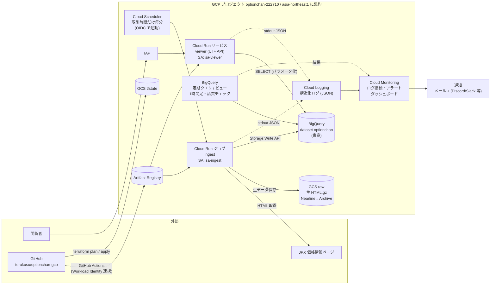

# 新アーキテクチャ（リファクタリング後・設計案）

- 時点: 2026-10-12（設計案。未合意の論点は「9. 決めること」）
- 対になる資料: [現行アーキテクチャ](current.md)（Before）
- 方針: **モダン化・IaC 化・オブザーバビリティ強化**。個人プロジェクトなので「月額を今と同程度（約 400〜500 円）に抑える」「運用の手間を減らす」を同じくらい重視する

## 1. 設計方針

| # | 方針 | 現行の課題との対応 |
|---|---|---|
| P1 | **すべて Terraform で管理**し、デプロイは GitHub Actions から行う（手作業のデプロイをやめる） | IaC なし、ドリフト |
| P2 | **リージョンを東京（asia-northeast1）に集約**する（BigQuery も東京のデータセットへ移す） | 3 リージョン分散 |
| P3 | 実行基盤は **Cloud Run（サービス / ジョブ）** に統一し、**App Engine と第1世代 Cloud Functions をやめる** | 廃止ランタイム、第1世代 |
| P4 | 認証は **IAP と IAM に寄せ、共有パスワードを無くす**。関数の `allUsers` 公開をやめる | #3、公開エンドポイント |
| P5 | サービスごとに **専用サービスアカウント（最小権限）**。ユーザー管理の SA 鍵は使わない（CI も Workload Identity 連携） | デフォルト SA、SA 鍵 |
| P6 | 取り込みは **生データ（HTML）を保存してから解析**する。解析のバグを後から再処理で直せるようにする | #4（元の `MM/DD` が残っておらず過去データを正確に直せない） |
| P7 | 書き込み順を「データ → 状態」にし、**表示側は BigQuery の実データだけを見る** | #5 |
| P8 | **オブザーバビリティを最初に入れる**（鮮度・エラー・データ品質のアラート）。リファクタ中の事故検知と Before/After の比較に使う | 監視なし、LINE Notify 終了 |
| P9 | 集計は関数ではなく **BigQuery の定期クエリ / ビュー**で行う | `insert_ohlc`（python37） |

## 2. システム構成図（After）



なくなるもの: App Engine、Cloud Functions 7 個、Pub/Sub 3 トピック、Datastore、GCS `optionchan`（中継）、共有パスワード（`auth.txt`）、`stackdriverLineNotify`。

## 3. コンポーネント設計

### 3.1 取り込み（ingest）

- **Cloud Run ジョブ**（Python 3.13）。Cloud Scheduler が OIDC 付きで直接起動する（Pub/Sub を挟まない）
- **起動は取引時間だけ**: 平日 8:45〜15:45 と 17:00〜翌 6:00（土曜早朝を含む）の cron を複数登録する。祝日の取引有無は JPX ページの更新有無で判断する（ページが更新されていなければ何もしない）。現行の毎分 24 時間起動に比べて起動回数は約 6 割
- 処理順:
  1. 1限月・2限月のページを取得し、**生 HTML を GCS `raw` に保存**（`raw/YYYY/MM/DD/HHMM_{1,2}.html.gz`）
  2. 解析して `spot_price` / `future_price` / `option_price` の行を作る（解析は純粋関数。#2 のテストをそのまま移植）
  3. **BigQuery Storage Write API**（コミット型ストリーム）で 3 テーブルに書く。重複防止はスナップショット時刻（`created_at`）をキーに、直前のスナップショット時刻と比べて判定
  4. 直前のスナップショット時刻は BigQuery の最新 `created_at` を参照する（Datastore をやめる。1 日数百回の小さなクエリはパーティション指定で数 MB 程度）
- 解析エラーは **行単位で隔離**し、1 行の異常でスナップショット全体を落とさない（エラー行数をログ指標にする）
- **再処理ジョブ**: 生 HTML から任意の期間を解析し直して BigQuery に書き直せるようにする（同じコンテナを引数違いで起動）

### 3.2 データ（BigQuery）

- 東京に新しいデータセットを作り、現行の US データセットから **データセットコピー**で移す（約 78GB。ロケーションは後から変えられないため）
- テーブルは現行のスキーマを基本に維持する（ビューアーと過去データとの互換のため）。追加・変更:
  - `ingest_run_id`（取り込みの実行 ID）を追加し、ログと突き合わせられるようにする
  - `price_time` は DATETIME（JST）のまま。過去データの補正（#4）は再処理ジョブまたは推定 SQL で別途行う
- **1 時間足**（現 `insert_ohlc`）は BigQuery の **定期クエリ**に置き換える
- 表示用の集計（スマイルカーブ・ATM 推移）は **ビュー / テーブル関数**にして、API はそれを読むだけにする
- 古いパーティションは長期保存料金（90 日で自動的に約半額）に任せ、削除はしない

### 3.3 ビューアー（App Engine をやめる）

- **Cloud Run サービス 1 つ**に UI（静的ファイル）と API をまとめる。最小インスタンス 0（使わないときは課金なし）
- 認証は **IAP**（Cloud Run への IAP 直接設定。使えない構成ならロードバランサ + IAP）。閲覧できるのは指定した Google アカウントだけ
- API は BigQuery を **直接・パラメータ化クエリで**読む（関数への中継と共有パスワードをやめる）
- フロントエンドは Chart.js を最新版に揃え、ビルド済みの静的ファイルをコンテナに同梱する（CDN 依存をやめる）
- 代案: 画面を作り込まないなら **Looker Studio**（BigQuery 直結、コード不要）。ただし細かいチャート（スマイルカーブの 2 軸など）は再現しにくい

### 3.4 オブザーバビリティ

| 対象 | シグナル | 実装 | アラート条件（案） |
|---|---|---|---|
| 鮮度 | 最新スナップショットの遅れ | ingest が成功時に `snapshot_saved` を構造化ログに出す → ログ指標 | 取引時間中に 10 分以上 `snapshot_saved` が無い |
| エラー | 実行失敗・解析エラー行 | Cloud Run ジョブの失敗数、`parse_error` ログ指標、Error Reporting | 失敗が 3 回連続 / 解析エラー行が 1 スナップショットで 5% 超 |
| データ品質 | 行数・NULL 率・`price_time` の妥当性 | BigQuery 定期クエリ（1 時間ごと）が結果をログに出す | 未来の `price_time`・日曜の日付・行数の急減が 1 件以上 |
| ビューアー | エラー率・レイテンシ | Cloud Run の標準指標 | 5xx が 5 分で 3 件以上 |
| コスト | 月額・BigQuery スキャン量 | 予算アラート、`INFORMATION_SCHEMA.JOBS` | 予算の 80% / 100% |

- ログはすべて **JSON の構造化ログ**（`severity`、`ingest_run_id`、`snapshot_at`、`rows` 等）で stdout に出す
- **ダッシュボード**（鮮度・取り込み行数・エラー・コスト）とアラートポリシーも Terraform で管理する
- 通知先: メール + チャット（Discord / Slack 等、要決定）。LINE Notify はサービス終了のため使わない

### 3.5 セキュリティ

- サービスアカウント: `sa-ingest`（GCS raw への書き込み、BigQuery データ編集）、`sa-viewer`（BigQuery 読み取り）、`sa-scheduler`（ジョブ起動）、`sa-deploy`（GitHub Actions 用）
- 既存の `optionchan` SA のユーザー管理鍵は削除する。App Engine デフォルト SA の権限は移行後に外す
- エンドポイントの一般公開は無し（ビューアーは IAP、ジョブは Scheduler からのみ起動）
- 秘密情報は原則持たない。必要になった場合だけ Secret Manager（1 値 1 シークレット）

## 4. IaC・CI/CD

```
infra/
├── bootstrap/        # tfstate バケット、Workload Identity 連携、sa-deploy（初回だけ手で apply）
├── envs/prod/        # 本番の root module（backend = GCS）
└── modules/
    ├── ingest/       # Cloud Run ジョブ、Scheduler、GCS raw、SA
    ├── data/         # BigQuery データセット・テーブル・ビュー・定期クエリ
    ├── viewer/       # Cloud Run サービス、IAP、SA
    └── observability/# ログ指標、アラート、通知チャネル、ダッシュボード、予算
```

- ツール: Terraform（google / google-beta プロバイダ）、state は GCS（バージョニング有効）
- 既存リソースは `import` ブロックで取り込んでから変更する（作り直さない）。BigQuery のテーブルは `deletion_protection = true`
- アプリ: `uv` で依存管理、`ruff`、`pytest`。コンテナは Artifact Registry
- GitHub Actions（Workload Identity 連携、SA 鍵なし）:
  - PR: テスト・lint・`terraform plan`（結果を PR にコメント）
  - `master` へのマージ: コンテナのビルド・push → `terraform apply`（GitHub の Environment で手動承認を挟む）

## 5. リポジトリ構成（After）

```
optionchan-gcp/
├── apps/
│   ├── ingest/       # 取り込み (Cloud Run ジョブ)。jpx_loader の後継
│   └── viewer/       # UI + API (Cloud Run サービス)
├── sql/              # ビュー・定期クエリ・品質チェック・移行 SQL
├── infra/            # Terraform
├── tests/
├── docs/architecture/
└── .github/workflows/
```

## 6. 移行計画

本番は毎分取り込み中なので、**新旧を並行稼働させて比較してから切り替える**。

| フェーズ | 内容 | 切り戻し |
|---|---|---|
| 0. 先行監視 | 現行構成に鮮度・エラーのアラートと新しい通知チャネルを入れる（Terraform で作り始める）。Before の指標を取り始める | 削除するだけ |
| 1. 基盤 | Terraform の bootstrap、Workload Identity 連携、Artifact Registry、CI | 影響なし |
| 2. 取り込みの新設 | 東京に新データセットを作り、新 ingest を並行稼働（新データセットにだけ書く）。旧と新のスナップショットを毎日突き合わせる | 新を止めるだけ |
| 3. データ移行 | 旧データセットの過去データを東京へコピー。並行稼働期間の重複を整理 | 旧データセットは残っている |
| 4. ビューアー切替 | 新 viewer を IAP 付きで公開。旧 App Engine と見比べる | 旧 URL はそのまま |
| 5. 旧系の停止 | Scheduler 停止 → 旧 Functions・Pub/Sub・Datastore・GCS 中継を削除。App Engine はアプリごとは削除できないので無効化（またはバージョン削除） | フェーズ 5 は一定期間（例: 2 週間）様子を見てから |
| 6. 後片付け | 旧 US データセットの削除（バックアップ後）、`jikken`、旧 SA 鍵、App Engine の旧バージョン、`stackdriverLineNotify` | — |

既存 Issue との関係: #3（共有パスワード）はフェーズ 4 で不要になる。#5（スマイルカーブ）は新 viewer で解消。#4（過去データ補正）はフェーズ 2 以降の再処理ジョブ・推定 SQL で行う。#2 は現行構成で先に直す（PR #6）。

## 7. コスト見積もり（月額・概算）

| 項目 | 現行 | After |
|---|---|---|
| 取り込みの実行 | Cloud Functions 毎分 24 時間 | Cloud Run ジョブ 取引時間のみ（無料枠内に収まる見込み） |
| BigQuery 保存 | 約 78GB（US） | 同程度（東京は単価がやや高い。長期保存料金で半額） |
| GCS | 中継のみ | 生 HTML: 1 スナップショット約 48KB（gzip、2 ページ）× 1 日約 800 回 ≒ 1 日約 40MB、年約 10GB（Nearline → Archive で月数十円以下） |
| ビューアー | App Engine（アイドル 1 インスタンス許容） | Cloud Run 最小 0 |
| 合計 | 約 400〜460 円（2026-07〜09 実績） | 同程度を目標（予算アラートで監視） |

## 8. 採用しなかった案

| 案 | 理由 |
|---|---|
| Cloud Run functions（第2世代）に載せ替えるだけ | 最小の変更で済むが、P6・P7（生データ保存、書き込み順）や構成の整理が進まない。ingest は「ジョブ」の方が実態（定期バッチ）に合う |
| GKE / Compute Engine | 個人の小規模用途に対して運用負荷とコストが大きい |
| Firestore / Bigtable 等への移行 | 分析中心の用途で、BigQuery が最適。データ量も BigQuery の得意な範囲 |
| Pub/Sub を残す | 起動は Scheduler → Cloud Run の直接呼び出しで足りる。中継を減らす |
| Pulumi / CDK for Terraform | 情報量・GCP の公式サンプルの多さで Terraform を選ぶ |

## 9. 決めること

| # | 論点 | 推奨 |
|---|---|---|
| D1 | ビューアーを自前の Cloud Run にするか、Looker Studio にするか | Cloud Run（スマイルカーブ等の既存チャートを再現するため） |
| D2 | BigQuery を東京へ移すか、US のままにするか | 東京へ移す（他のリソースと同じ場所にし、リージョン間通信をなくす） |
| D3 | 通知先のチャット（Discord / Slack / なし） | — |
| D4 | 生 HTML の保存期間（ずっと / 1 年 等） | ずっと（Archive クラスで低コスト。再処理の元データになる） |
| D5 | `jikken` と `PaymentInfo`（課金エクスポート）の扱い | `jikken` は削除、`PaymentInfo` はコスト監視に使うので残す |
| D6 | 移行中の過去データ補正（#4）の時期 | データ移行（フェーズ 3）と同時に行う |
